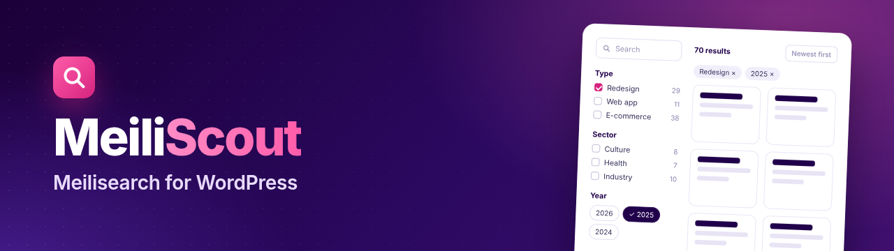
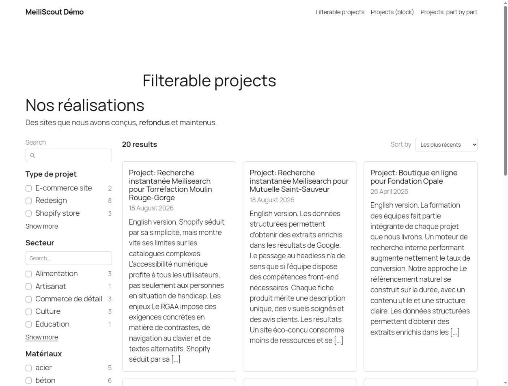
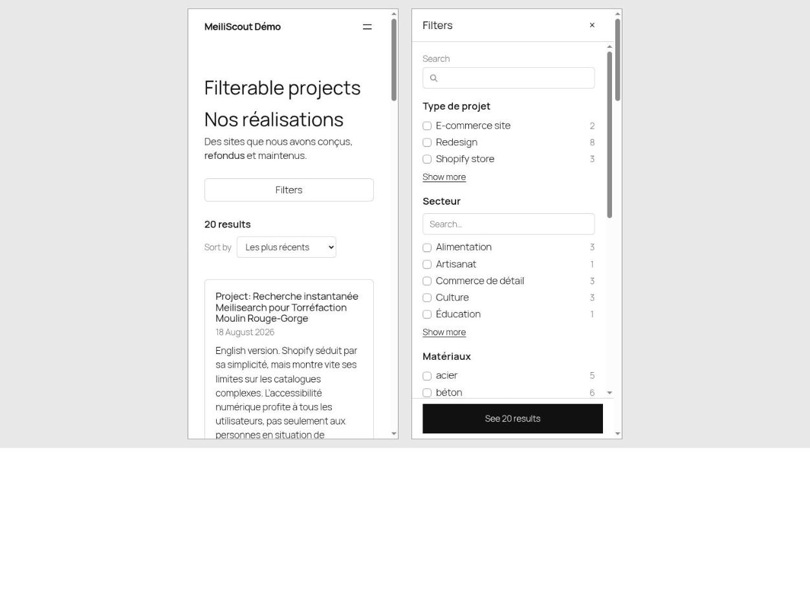
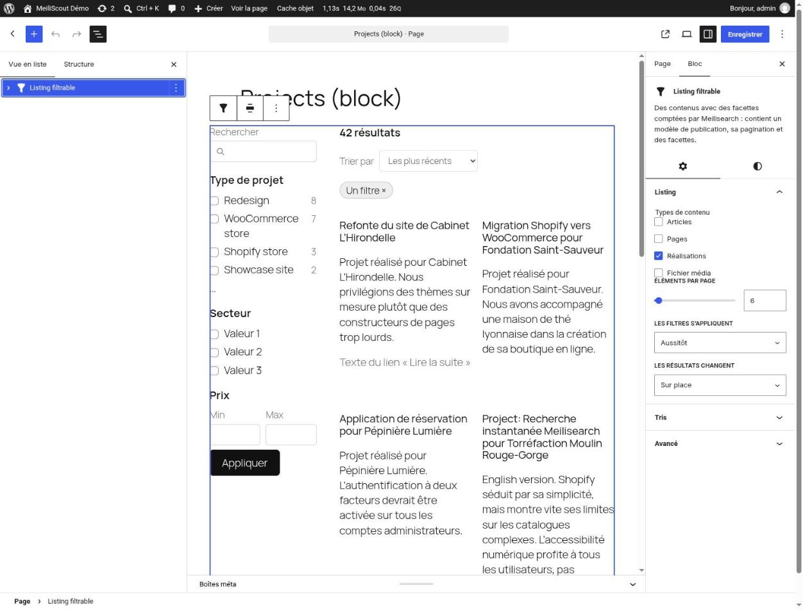
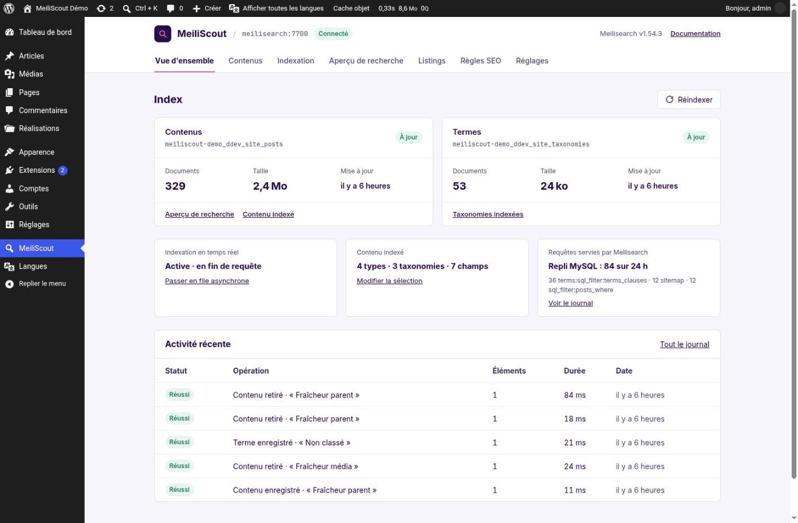

<p align="center">
  
</p>

<p align="center">
  <a href="https://github.com/AmphiBee/MeiliScout/releases/latest"></a>
  <a href="https://github.com/AmphiBee/MeiliScout/actions/workflows/tests.yml"></a>
  
  
  
</p>

# MeiliScout

[Meilisearch](https://www.meilisearch.com/) for WordPress: your posts and terms indexed as they change, `WP_Query` and `get_terms()` answered by Meilisearch **when it can answer them exactly as MySQL would**, and filterable listings on the front end, built in the block editor or in code.

## Why MeiliScout

- **Never a different result.** A query is either translated faithfully to Meilisearch or it runs on MySQL, with the reason recorded (`unindexed_meta:price`, `unsupported_arg:author`...). Posts are loaded from the database, `found_posts` and the pagination are exact. Nothing in your theme or plugins has to change. [Coverage](docs/WP_QUERY.md).
- **Indexing that follows the site.** Post types, taxonomies and meta keys chosen in the admin; content re-indexed when it changes, at the end of the request or in the background; full indexations that build new indexes beside the old ones and switch when done, without downtime.
- **Filterable listings.** Facets with their counts, sorts, search, active filters, pagination, counted by the visitor's browser straight on Meilisearch. One canonical URL per state, facets in the path, SEO through the plugin you already use, Polylang and WPML. Works without JavaScript. [Step-by-step guide](docs/LISTINGS_GUIDE.md).
- **Yours to build with.** Drop in the *Filterable listing* block, or declare the listing in PHP and print it whole or part by part from PHP, Blade or Twig. A default look that follows your theme, and tokens to change it.
- **An admin that tells you what happens.** Overview and health, what is indexed, indexation and its log, a search preview, a `WP_Query` tester, the listings and their SEO rules. Export the configuration to move it to another site.

<table>
  <tr>
    <td width="50%"><br><sub>A listing: facets with counts, sort, cards, pagination.</sub></td>
    <td width="50%"><br><sub>On a phone, the filters open as a sheet.</sub></td>
  </tr>
  <tr>
    <td width="50%"><br><sub>In the block editor, with the core's own blocks.</sub></td>
    <td width="50%"><br><sub>The admin: health, content, queries served, activity.</sub></td>
  </tr>
</table>

## Requirements

- PHP 8.2 or later, WordPress 6.6 or later (6.9 for the front listings).
- A Meilisearch instance (1.x), its URL and an admin key (one allowed to manage keys, for the listings).

## Installation

Download the zip of the [latest release](https://github.com/AmphiBee/MeiliScout/releases/latest), which ships its dependencies, and install it in `wp-content/plugins`; or require the package `amphibee/meiliscout` with Composer (Bedrock, Pollora), whose autoloader then loads it. Then activate it.

## Quick start

1. **Connect.** *MeiliScout › Settings › Connection*: the instance's URL and a key, or the variables below.
2. **Choose what to index.** *MeiliScout › Content*: post types, taxonomies, custom fields.
3. **Index.** *MeiliScout › Indexation*, or `wp meiliscout index`.

Then ask Meilisearch for a query (see [Querying](#querying)), turn on the kinds of queries it serves on its own (*Settings › Queries*: the site search, archives, REST searches), or build a [listing](#front-listings). The complete walkthrough, with a screenshot of each screen: [docs/CONFIGURATION.md](docs/CONFIGURATION.md).

Each connection setting can come from the environment or a constant instead, and is then read-only in the admin:

| Variable or constant | |
|---|---|
| `MEILI_HOST` | The instance's URL |
| `MEILI_KEY` | Its admin key |
| `MEILI_SEARCH_KEY` | A search key, for searches (optional) |
| `MEILI_INDEX_PREFIX` | Prefix of the index names (default: the site's domain) |
| `MEILISCOUT_ASYNC_INDEXING` | `true`: real-time indexing in the background (WP-Cron); `false`: at the end of the request |

## Querying

```php
$query = new WP_Query([
    'post_type' => 'project',
    'tax_query' => [['taxonomy' => 'project_type', 'terms' => [12]]],
    'meta_query' => [['key' => '_price', 'value' => 5000, 'compare' => '<=', 'type' => 'NUMERIC']],
    'use_meilisearch' => true,
]);

$query->meiliscout; // served or not, why, the search sent
```

The meta keys a query filters or sorts on must be indexed (*MeiliScout › Content › Custom fields*). The `X-MeiliScout` header, the Query Monitor panel and *MeiliScout › Search preview › Query arguments* say what happened to a query.

## Front listings

In the block editor, insert **Filterable listing**. Or in code:

```php
add_action('init', function () {
    meiliscout_register_listing('projects', [
        'post_types' => ['project'],
        'route' => ['page' => 42],
        'facets' => [
            'type' => ['source' => 'taxonomy:project_type', 'path' => 'type'],
            'price' => ['source' => 'meta:_price', 'type' => 'range'],
            'year' => ['source' => 'date', 'display' => 'chips'],
        ],
    ]);
});

// In the page's template (or <x-meiliscout::listing id="projects" /> in Blade)
meiliscout_listing('projects');
```

Turn the module on in *MeiliScout › Settings › Listings*. Build your first listing with the [step-by-step guide](docs/LISTINGS_GUIDE.md); everything else, from the cards to the SEO rules: [docs/LISTINGS.md](docs/LISTINGS.md).

## Documentation

| | |
|---|---|
| [Configuration](docs/CONFIGURATION.md) | Connect, index, serve queries, listings settings, export and import the configuration, deploy to another server |
| [Listings guide](docs/LISTINGS_GUIDE.md) | A listing step by step, in blocks and in code (PHP, Blade, Twig), with screenshots |
| [Listings reference](docs/LISTINGS.md) | Every option: facets, transports, URLs, SEO, languages, markup, UI kit |
| [WP_Query](docs/WP_QUERY.md) · [Terms](docs/TERM_QUERY.md) | What is translated, what falls back to MySQL and why |
| [Filters](docs/FILTERS.md) | The hooks, from what is indexed to the search parameters sent |
| [Changelog](CHANGELOG.md) | The changes by version |

## WP-CLI

```sh
wp meiliscout index                 # full indexation
wp meiliscout status                # the indexes searches read and write, a pending migration
wp meiliscout check-queries         # WP_Query on MySQL and on Meilisearch, compared
wp meiliscout check-queries --terms # get_terms(), the same way
wp meiliscout check-listings        # the front listings: checks, counts against MySQL, URLs
wp meiliscout bench-listings <id>   # a listing's page, fragment and counts, timed
wp meiliscout seo-rules list|export|import|preview
wp meiliscout export [<file>]       # the configuration, as JSON
wp meiliscout import <file>         # what a file would change (a dry run); --apply writes it
```

## Development

```sh
composer install && npm install
npm run build                 # admin and listings assets
vendor/bin/pest               # unit tests
npm run test:js               # the listings' client
composer test:types           # PHPStan
composer test:integration     # against a WordPress with Meilisearch (the demo site)
```

## License

MIT, by [AmphiBee](https://amphibee.fr).
