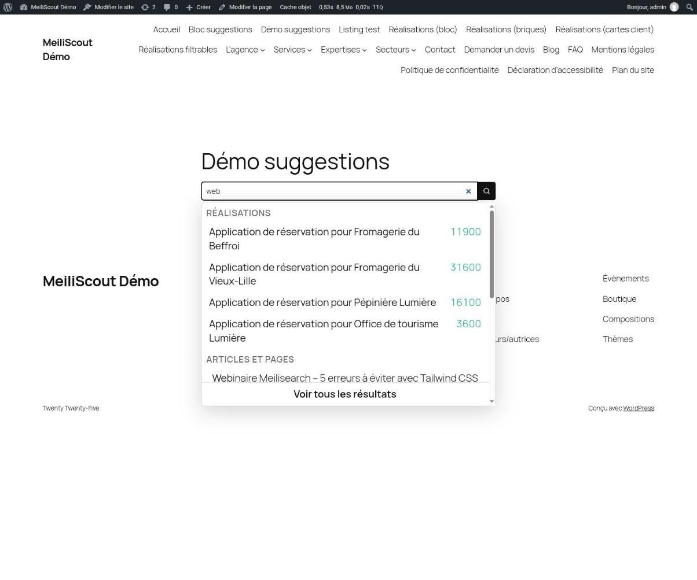
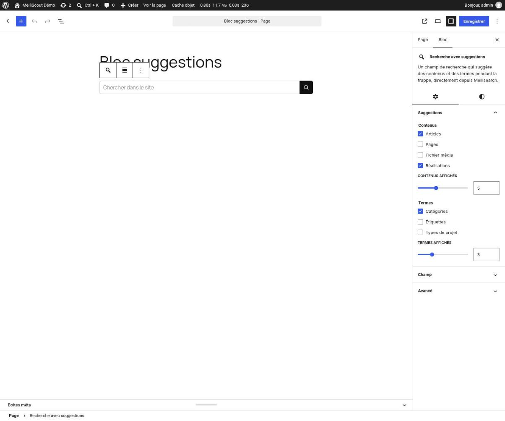
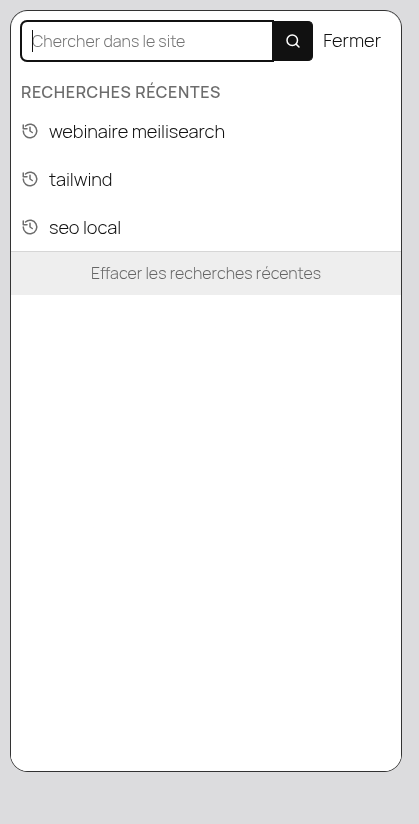
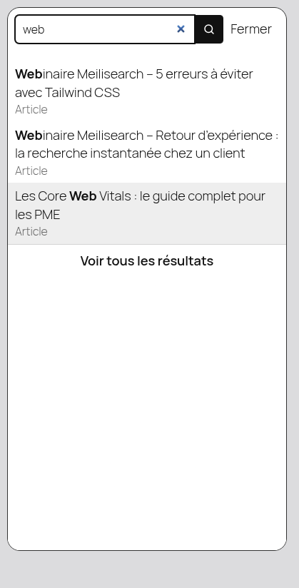
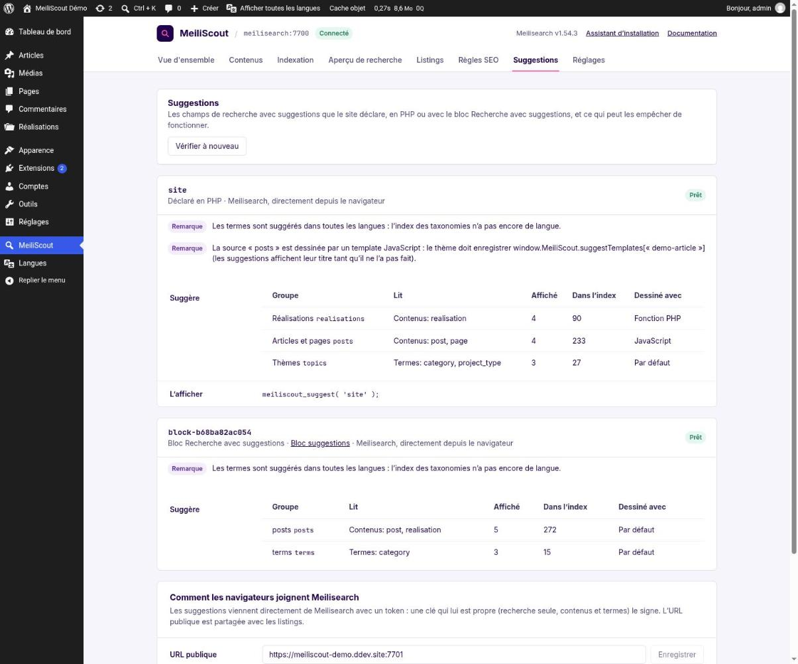

# Search with suggestions: a step-by-step guide

This guide builds a search field that suggests posts and terms **as the visitor types**, straight from Meilisearch, in the two ways MeiliScout offers:

- **[Editor mode](#2-editor-mode-in-the-block-editor)**: the *Search with suggestions* block, or a setting on the core *Search* block. No code.
- **[Developer mode](#3-developer-mode-in-code)**: you declare the field in PHP, and draw its suggestions with HTML, **PHP**, **Blade**, **Twig** or **JavaScript**.

Both give the same field. For every option, see [AUTOSUGGEST.md](AUTOSUGGEST.md); the design and the measures are in [plans/2026-10-autosuggest.md](plans/2026-10-autosuggest.md). The screenshots are of a French admin.

| | |
|---|---|
|  | The field on a wide screen: the suggestions come in groups, the typed part in bold, a link to all the results always in sight. The projects' price comes from a PHP template ([below](#35-your-own-suggestions)). |

## Contents

1. [Before you start](#1-before-you-start)
2. [Editor mode: in the block editor](#2-editor-mode-in-the-block-editor)
3. [Developer mode: in code](#3-developer-mode-in-code)
4. [On a phone](#4-on-a-phone)
5. [Checking your work](#5-checking-your-work)
6. [Troubleshooting](#6-troubleshooting)

---

## 1. Before you start

1. **MeiliScout connected to Meilisearch**, with the content to suggest **indexed** (MeiliScout › Indexation). Featured images are suggested from the posts index's format 6: if `wp meiliscout status` says otherwise, run a full indexation.
2. **A URL browsers can reach Meilisearch at** (MeiliScout › Suggestions › *Public URL*, shared with the listings). Without one, browsers use the address the server uses, which they usually cannot reach: either set it, or let WordPress run the searches (`'transport' => 'rest'`, slower).
3. Nothing else: no module to turn on. A site that declares no field loads no script or style.

## 2. Editor mode: in the block editor



1. Add the **Search with suggestions** block (MeiliScout category).
2. In *Suggestions*, tick what to suggest: post types (*Posts*) and taxonomies (*Terms*), and how many of each.
3. In *Field*, set the label (for screen readers), the placeholder, the characters before suggesting, whether recent searches are kept, the results page and how the field searches.

The field is saved with the page, so its token can be renewed from any request. Two blocks with the same settings are one field.

**The core Search block** can be the same field: declare one in PHP (below), then pick it in the *Suggestions (MeiliScout)* panel of the Search block. Its label and placeholder are kept.

## 3. Developer mode: in code

### 3.1 Declare the field

```php
add_action('init', function () {
    meiliscout_register_suggest('site', [
        'sources' => [
            'projects' => ['post_types' => ['project'], 'limit' => 4, 'label' => 'Projects'],
            'articles' => ['post_types' => ['post', 'page'], 'limit' => 4, 'label' => 'Articles'],
            'topics'   => ['type' => 'terms', 'taxonomies' => ['category'], 'limit' => 3, 'label' => 'Topics'],
        ],
    ]);
});
```

Every error of a definition is given at once (an unindexed post type, an unknown option...), in the admin and in `wp meiliscout check-suggest`.

### 3.2 Print it

```php
meiliscout_suggest('site');                              // prints
$html = meiliscout_get_suggest('site', ['placeholder' => 'Search the site…']);
```

In Blade `{!! meiliscout_get_suggest('site') !!}`, in Twig `{{ meiliscout_get_suggest('site')|raw }}`.

### 3.3 The field is a real form

It submits to the results page (`results_url`, the site's search page by default) with the query in `s`. Without JavaScript, or when Meilisearch cannot be reached, it is a plain search. With JavaScript it is an accessible combobox: arrows, Enter, Escape, and a live region announcing the count.

### 3.4 What it does to be quick

One request per keystroke, to Meilisearch (about 5 ms of engine time; the plan has the measures), a short debounce, the previous request aborted, the previous suggestions kept on screen until the new ones come, the last answers remembered, and only the fields the template reads asked for.

### 3.5 Your own suggestions

A source's `template` says how its suggestions are drawn; it is compiled once, when the page is rendered, so no PHP runs while the visitor types. HTML, a PHP callable or class, a theme template part, **Blade**, **Twig** and a **JavaScript** function all work: see [Drawing a suggestion](AUTOSUGGEST.md#drawing-a-suggestion). For example, a project with its price:

```php
'projects' => [
    'post_types' => ['project'],
    'public_metas' => ['price'], // on the field, not the source
    'template' => fn ($source, $suggest, $hit) => '<a class="hit" '.$hit->option().$hit->href().'>'
        .$hit->title().'<span '.$hit->text('metas.price').'></span></a>',
],
```

## 4. On a phone

 

Under 782 px a tap on the field opens a **full-screen sheet**: the field and a *Close* button at the top, the suggestions below, three per group, the page behind locked. The keyboard never covers them (the sheet follows the visual viewport), the back button closes the sheet, and scrolling the suggestions puts the keyboard away without closing it.

Empty, the field shows the visitor's **recent searches** (kept in their own browser, five per field, with a *Clear* button): nothing is sent anywhere.

## 5. Checking your work



MeiliScout › **Suggestions** (it shows once a field is declared) and `wp meiliscout check-suggest` say, for each field: its definition, the documents each group reads, the index's format, the key and token (and a search with it, as a browser would), the public URL, and what a JavaScript template needs. **Replace the key** makes a new one and refuses every token given so far.

## 6. Troubleshooting

| | |
|---|---|
| The field searches as a plain form | No token (the admin key may not manage keys), Meilisearch unreachable from the browser (the *Public URL*), or HTTPS pages calling an HTTP Meilisearch: see the Suggestions screen |
| Suggestions are missing a type | It is not indexed (MeiliScout › Content), or the index is empty: run an indexation |
| No images | The posts index is older than format 6: run a full indexation; the posts need a featured image |
| A JavaScript template shows only titles | Its function is not registered: `window.MeiliScout.suggestTemplates['name']` |
| Terms of every language appear | The taxonomies index has no language yet |
