# Configuring MeiliScout

This guide takes you from a fresh install to a working search: connecting to Meilisearch, choosing what to index, running the first indexation, deciding which queries Meilisearch serves, and checking that everything works. Each step shows the admin screen it happens on.

The admin is one page, **MeiliScout**, with seven screens: *Overview*, *Content*, *Indexation*, *Search preview*, *Listings*, *SEO rules* and *Settings*. (The *Listings* and *SEO rules* screens appear once the front listings module is on.) The screenshots come from a site whose admin language is French; the English labels are given in the text.

## Contents

1. [Before you start](#1-before-you-start)
2. [Connect to Meilisearch](#2-connect-to-meilisearch)
3. [Choose what to index](#3-choose-what-to-index)
4. [Run the first indexation](#4-run-the-first-indexation)
5. [Keep the index up to date](#5-keep-the-index-up-to-date)
6. [Decide which queries Meilisearch serves](#6-decide-which-queries-meilisearch-serves)
7. [Check that it works](#7-check-that-it-works)
8. [Turn on the front listings](#8-turn-on-the-front-listings)
9. [Advanced settings](#9-advanced-settings)
10. [Configuration by environment: variables and constants](#10-configuration-by-environment)
11. [Export and import the configuration](#11-export-and-import-the-configuration)
12. [Deploying to another server](#12-deploying-to-another-server)
13. [Troubleshooting](#13-troubleshooting)

---

## 1. Before you start

You need:

- PHP 8.2 or later and WordPress 6.6 or later (6.9 for the front listings);
- a **Meilisearch 1.x** instance you can reach from the web server, its URL and an **admin key**. For the front listings the key must be allowed to manage keys (MeiliScout creates a restricted key of its own for the browsers).

Install the release zip in `wp-content/plugins` (it ships its dependencies), or add the package `amphibee/meiliscout` to the site with Composer (Bedrock, Pollora), then activate the plugin. Activation changes nothing on the site's searches: MeiliScout serves nothing until it is connected and indexed.

---

## 2. Connect to Meilisearch

**MeiliScout › Settings › Connection.**

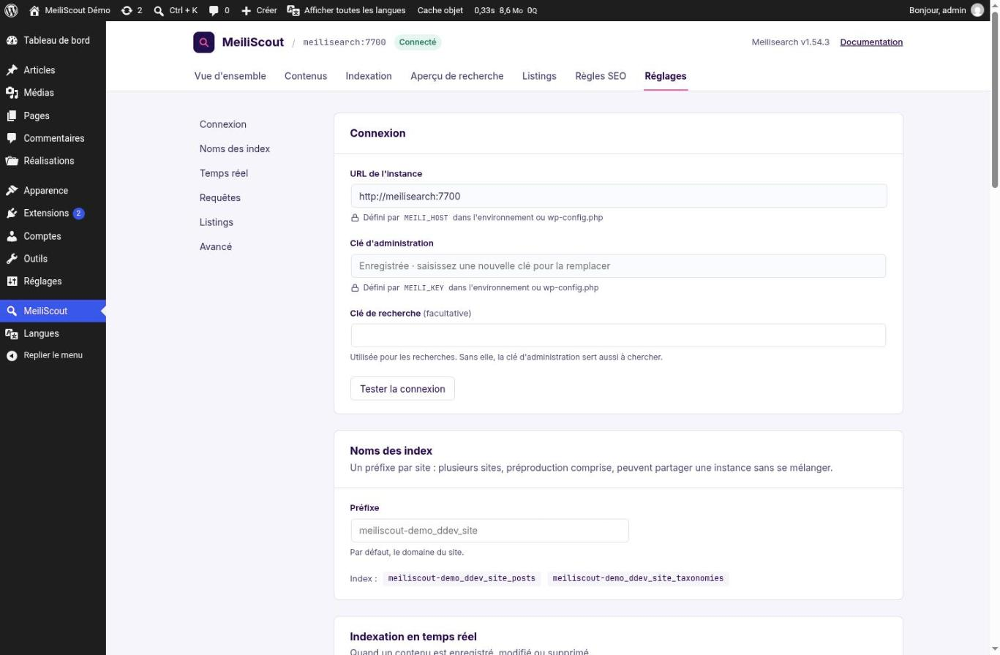

| Field | |
|---|---|
| **Instance URL** | Where the *server* reaches Meilisearch (`http://meilisearch:7700` in Docker, an HTTPS URL for a hosted instance) |
| **Admin key** | Used to index and to manage settings. It is never sent back to the browser: the field only says a key is saved, and leaving it empty keeps it |
| **Search key** (optional) | Used for searches. Without it the admin key also searches. Prefer a search key on a public production site |

Press **Test the connection** to check the URL and the key before saving.

A field that comes from the environment or a constant (`MEILI_HOST`, `MEILI_KEY`...) shows a lock and the name of the variable: it is read-only in the admin (see [section 10](#10-configuration-by-environment)). In the screenshot, the URL and the admin key are set by `MEILI_HOST` and `MEILI_KEY`.

### Index names

Right below, **Index names** has a **Prefix**: it defaults to the site's domain, so several sites, a staging site included, can share one Meilisearch without mixing their data. Two indexes are used: `<prefix>_posts` and `<prefix>_taxonomies`; the screen lists the names in use.

> Give a staging site and its production twin **different prefixes** if they share an instance: a full indexation on one must not replace the other's index.

---

## 3. Choose what to index

**MeiliScout › Content.** The page is organised in five sections, listed on the left: *Post types*, *Taxonomies*, *Custom fields*, *Term fields* and *Relevance*.

### Post types

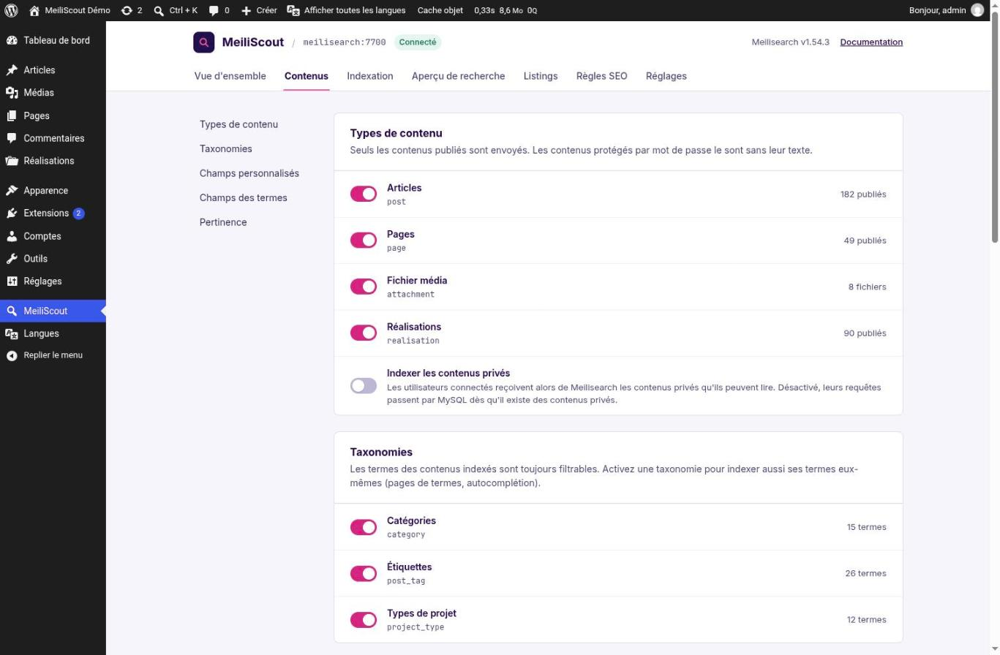

Switch on each post type Meilisearch should know. Only **published** content is sent; password-protected content is sent without its text. **Index private content** also sends the private content that connected users may read: while it is off, a query by a connected user goes to MySQL as soon as private content exists, so the result stays exact.

### Taxonomies

The terms of the indexed content are always filterable (a facet on categories works). Switching a taxonomy on indexes **the terms themselves** too: term pages, autocompletion, `get_terms()` served by Meilisearch.

### Custom fields

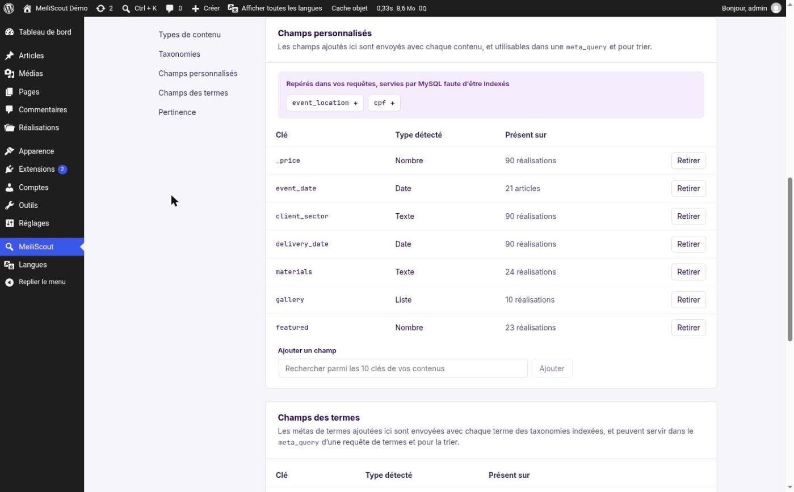

A custom field (meta key) is indexed **only if you add it**. For each one the screen shows the **type it detected** from the values (number, text, date, list) and how many posts have it; **Remove** takes it out. Add one with *Add a field*: the search offers the keys found in your content.

The purple notice at the top lists keys your `WP_Query` calls used but that are not indexed (`event_location`, `cpf` here): those queries are served by MySQL until the key is added, which is how you find what is worth indexing.

A custom field is what lets you filter (`meta_query`), sort on it, and use it as a **facet** in a listing. Add a field before declaring a listing that needs it.

### Term fields

The same, for the meta of **terms** (the colour of a category, a position): sent with each term of the indexed taxonomies, usable in a `get_terms()` `meta_query` and for sorting.

### Relevance

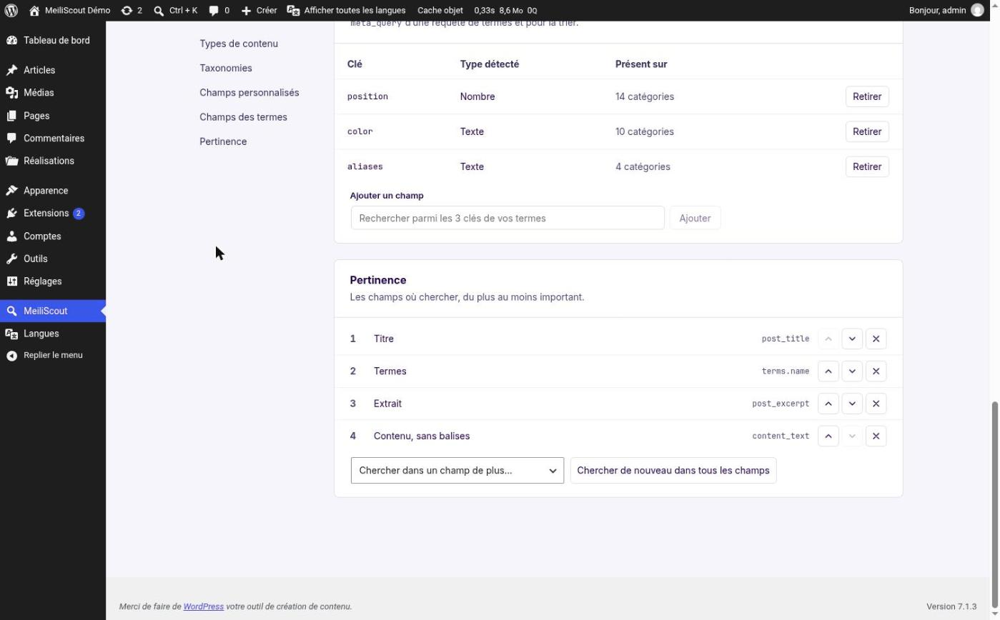

The fields searched, from the most to the least important: title first, then terms, excerpt and the text of the content. Move a field up or down, remove one, or add another with *Search in a field too*. A match in a field higher in the list ranks the result higher. **Search all fields again** restores the default.

> Changing what is indexed (post types, taxonomies, custom fields, the fields searched) changes the index's structure: run an indexation afterwards (next section). The Overview and Indexation screens tell you when one is needed.

---

## 4. Run the first indexation

**MeiliScout › Indexation.**

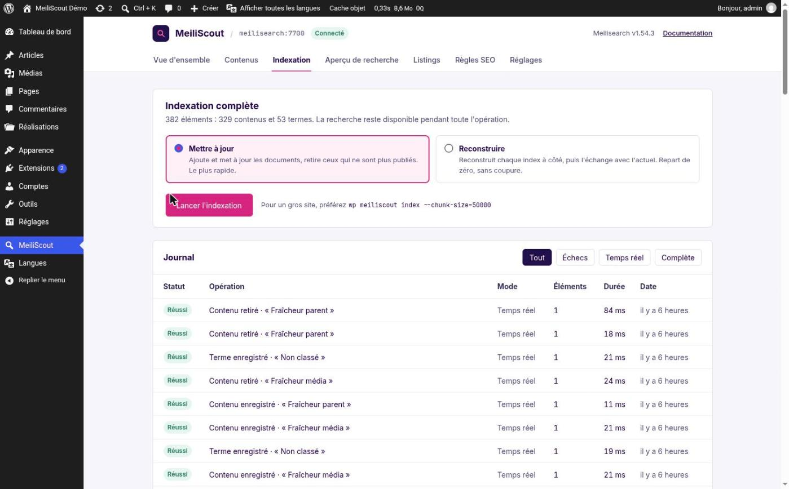

Two modes:

| Mode | What it does | When |
|---|---|---|
| **Update** | Adds and updates the documents, and removes those that are no longer published | The usual choice; the fastest. Search stays available |
| **Rebuild** | Builds each index **beside** the current one, then swaps them | After a change of structure (a new custom field, new relevance), or to start from scratch. Still without downtime |

Press **Run the indexation**. The page shows the progress and keeps a **log** of every operation (full indexations and real-time updates, with their status and duration); failed tasks are kept so you can retry them.

For a large site, run it from the command line, in chunks that each use their own process (no memory build-up):

```bash
wp meiliscout index                       # everything
wp meiliscout index --chunk-size=50000    # a big site, in chunks
wp meiliscout index --clear               # empty the indexes, then index
wp meiliscout status                      # the indexes searches read and write
```

---

## 5. Keep the index up to date

**MeiliScout › Settings › Real time.**

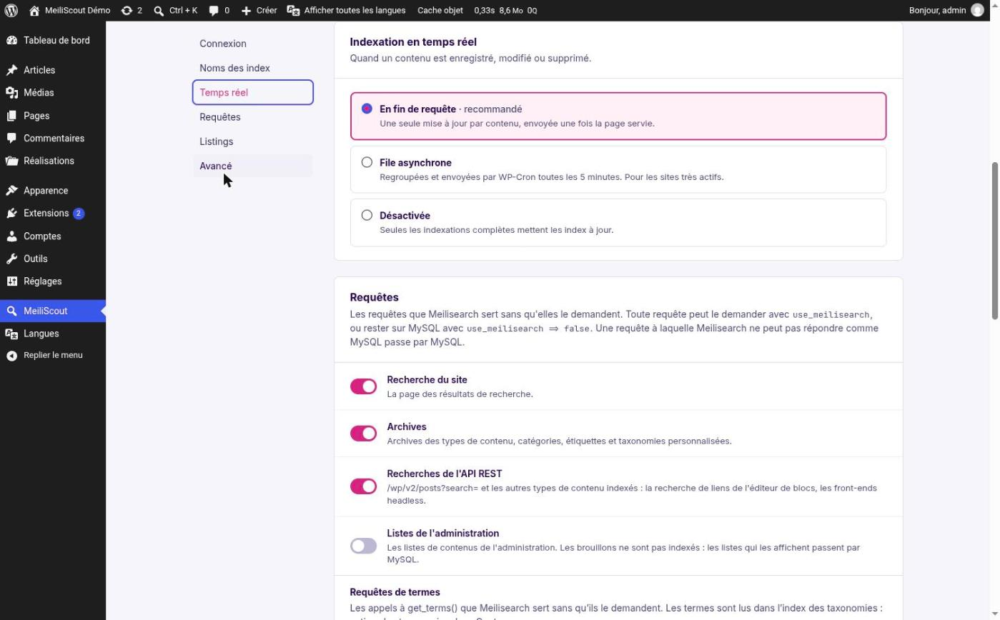

When a content is saved, changed or deleted, MeiliScout can update the index at once:

| Mode | |
|---|---|
| **At the end of the request** (recommended) | One update per content, sent once the page has been served: the editor does not wait for it |
| **Async queue** | Changes are grouped and sent by WP-Cron every 5 minutes. For very active sites; the delay is `meiliscout/async_indexing_delay` |
| **Off** | Only full indexations update the indexes (a site that imports content in bulk and indexes after) |

During a big import, filter `meiliscout/skip_indexing` to pause real-time indexing, then run a full indexation. `MEILISCOUT_ASYNC_INDEXING` sets the mode from the environment.

The **Overview** screen shows the mode in use and offers to switch.

---

## 6. Decide which queries Meilisearch serves

**MeiliScout › Settings › Queries** (same screenshot as above).

MeiliScout can serve a `WP_Query` from Meilisearch in two ways: the code asks for it with `'use_meilisearch' => true`, or the site decides here that a **kind of query** is served without any code change:

| Switch | Queries served |
|---|---|
| **Site search** | The search results page |
| **Archives** | Post type, category, tag and custom taxonomy archives |
| **REST API searches** | `/wp/v2/posts?search=` and the other indexed types: the block editor's link search, headless front-ends |
| **Admin lists** | The lists of content in the admin. Drafts are not indexed, so lists that show them go through MySQL |
| **Term queries** | Calls to `get_terms()`, read from the terms index |

All are **off by default**: turn them on one at a time and check the result. Two rules protect the site:

- **Translate or fall back.** A query is either translated faithfully to Meilisearch, or it runs on MySQL, with the reason recorded (`unsupported_arg:author`, `unindexed_meta:price`...). A different result never comes back. The Overview shows *MySQL fallbacks* over 24 hours, by reason.
- A query can always opt out with `'use_meilisearch' => false`.

The coverage of `WP_Query` arguments and the fallback reasons: [WP_QUERY.md](WP_QUERY.md); for terms: [TERM_QUERY.md](TERM_QUERY.md).

---

## 7. Check that it works

### The Overview

**MeiliScout › Overview** is the dashboard.


- **Index cards** for contents and terms: the number of documents, the size, the last update, and whether the index is up to date.
- **Real-time indexing**: the mode in use, with a link to change it.
- **Indexed content**: how many types, taxonomies and fields, with a link to change them.
- **Queries served by Meilisearch**: the MySQL fallbacks of the last 24 hours, by reason, with the log.
- **Recent activity**: the last operations, with their status and duration.

### The search preview

**MeiliScout › Search preview.**

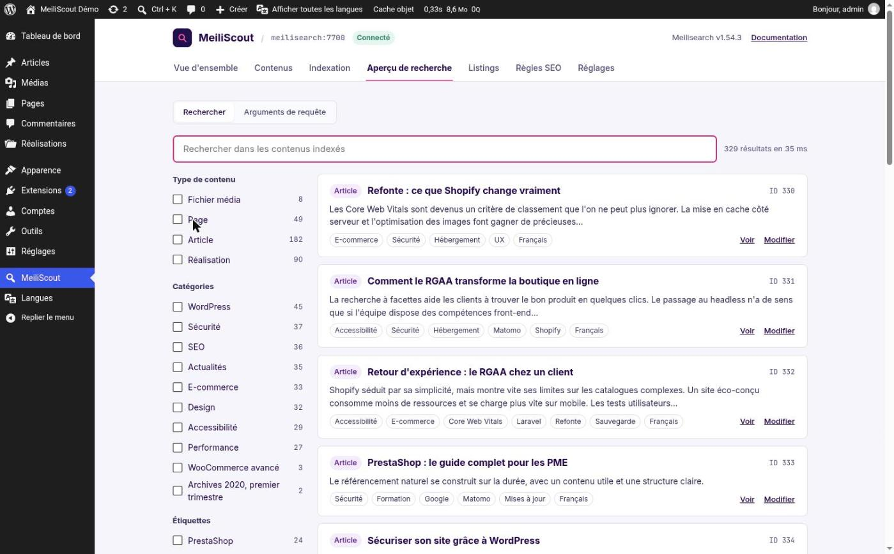

A search over what is indexed, as a visitor's search would see it: type to search, narrow with the facets on the left (content type, categories, tags...), see the time taken (35 ms here) and the facets' counts. Use it to check that a field is searched and a term found before exposing anything to visitors.

The second tab, **Query arguments**, is a `WP_Query` tester: give it the query's arguments and it tells you whether Meilisearch serves it, or the reason it falls back to MySQL. It is the quickest way to know whether *your* query is served.

### Command line

```bash
wp meiliscout status                # indexes read and written, a pending migration
wp meiliscout check-queries         # WP_Query on MySQL and on Meilisearch, compared (exit 1 on a difference)
wp meiliscout check-queries --terms # get_terms(), the same way
```

---

## 8. Turn on the front listings

**MeiliScout › Settings › Listings.** An optional module, off by default, to build filterable listings (facets with counts, sorts, search, pagination). It needs WordPress 6.9.

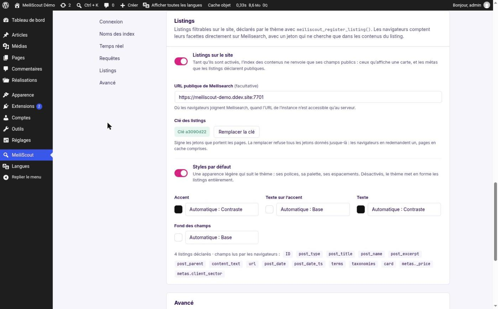

| Setting | |
|---|---|
| **Front listings** | The switch. While on, the contents index only returns its *public* fields: the ones a card shows and the meta keys listings declare public |
| **Public URL of Meilisearch** (optional) | Where *browsers* reach Meilisearch, when the instance URL is one only the server can reach (`http://meilisearch:7700`). Empty: the instance URL |
| **Listings key** | The key that signs the tokens carried by the pages (a token can only search the listing's own posts). **Replace the key** refuses every token given so far: browsers ask for a new one, cached pages included |
| **Default styles** | A light look that follows the theme. Turn off to style the listings entirely yourself |
| Colours | *Accent*, *Text on accent*, *Text*, *Field background*: automatic from the theme's palette, a palette colour, or your own |

At the bottom, the screen counts the **declared listings** and lists the **fields browsers can read**.

Then build a listing: [LISTINGS_GUIDE.md](LISTINGS_GUIDE.md) (step by step, in blocks or in code) and [LISTINGS.md](LISTINGS.md) (reference).

### The Listings screen

**MeiliScout › Listings.**

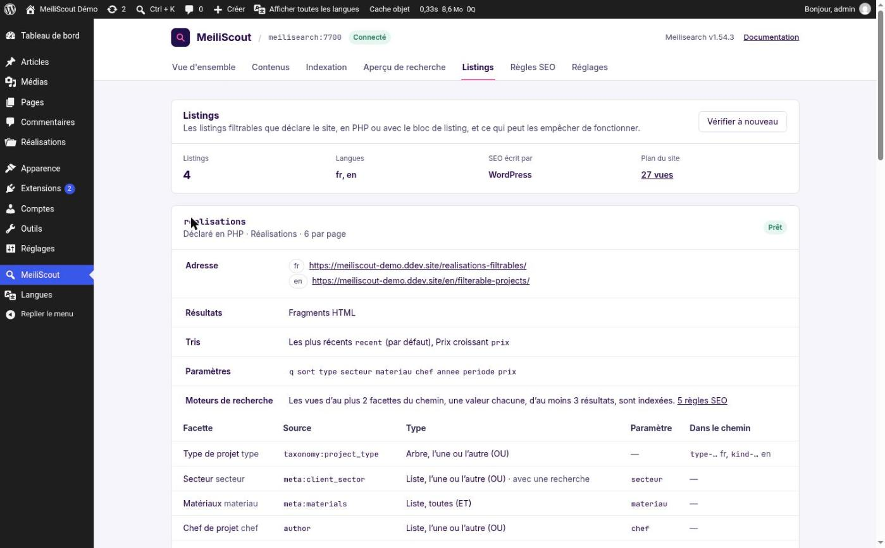

Every declared listing, from PHP or from a block, with its **address** in each language, how its results arrive, its sorts, its URL parameters, what search engines may index, and the table of its facets (source, type, parameter, whether it goes in the path). A badge says whether it is **ready**; if not, the checks say why (an unindexed source, a route without a page, two listings on one page...) and **Check again** reruns them, including its counts against MySQL.

### SEO rules

**MeiliScout › SEO rules.**

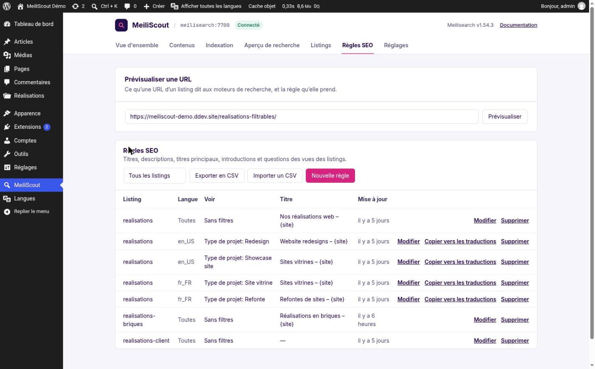

Titles, descriptions, headings, introductions and questions for the views of a listing. At the top, **Preview a URL** shows what a listing URL tells search engines, and the rule it takes. Below, the rules by listing, language and view, with **Export CSV** and **Import CSV** to edit them in bulk (and `wp meiliscout seo-rules list|export|import|preview`).

---

## 9. Advanced settings

**MeiliScout › Settings › Advanced.**

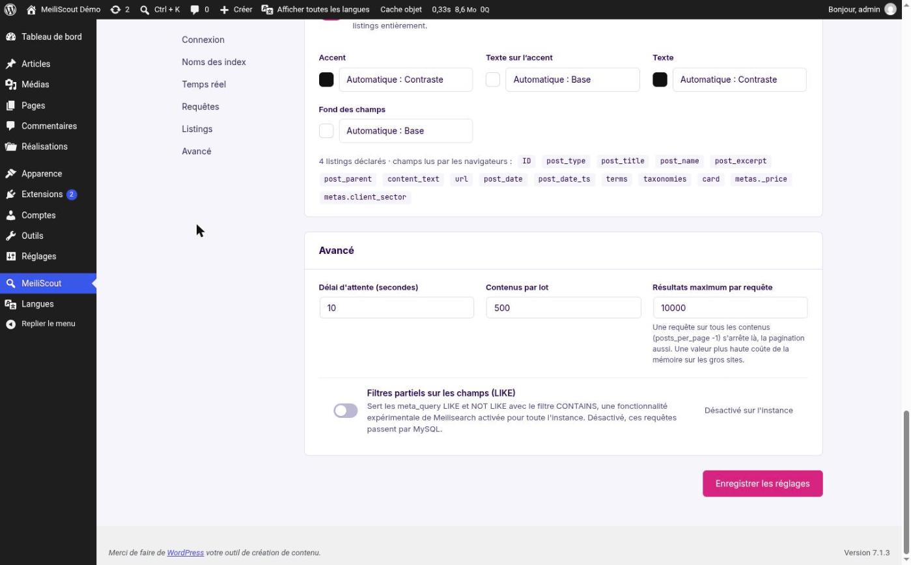

| Setting | Default | |
|---|---|---|
| **Timeout** (seconds) | 10 | How long a request to Meilisearch may take before the site gives up (and falls back to MySQL) |
| **Contents per batch** | 500 | Documents sent per request in a full indexation. Lower it if the server runs out of memory or Meilisearch refuses large payloads |
| **Maximum results per query** | 10,000 | A query for every post (`posts_per_page => -1`) stops there, and so does its pagination. A higher value costs memory on big sites |
| **Partial filters (LIKE)** | off | Serves `meta_query` with `LIKE` and `NOT LIKE` through Meilisearch's experimental `CONTAINS` filter, which is enabled **for the whole instance**. Off, those queries go to MySQL |

---

## 10. Configuration by environment

Anything that differs between servers (the connection above all) can come from the environment or a constant in `wp-config.php` instead of the admin. The field is then read-only, with a lock.

| Variable or constant | |
|---|---|
| `MEILI_HOST` | The instance's URL |
| `MEILI_KEY` | Its admin key |
| `MEILI_SEARCH_KEY` | A search key (optional) |
| `MEILI_INDEX_PREFIX` | Prefix of the index names (default: the site's domain) |
| `MEILISCOUT_ASYNC_INDEXING` | `true`: real-time indexing in the background (WP-Cron); `false`: at the end of the request |

The order of precedence is: environment, then constant, then the option saved in the admin. Keep keys out of the database and out of Git: the environment (a `.env` file next to the site, a secret of your host) is the place for them.

Everything else is a **filter** for developers (batch size, HTTP options, ranking rules, the fields searched...): see [FILTERS.md](FILTERS.md).

---

## 11. Export and import the configuration

**MeiliScout › Settings › Export / Import.** Moving a site's content is the database's job; its MeiliScout *configuration* (what is indexed, what is searched, the queries served, the front listings, the SEO rules) travels in one JSON file you can download, commit to Git and import on another site.

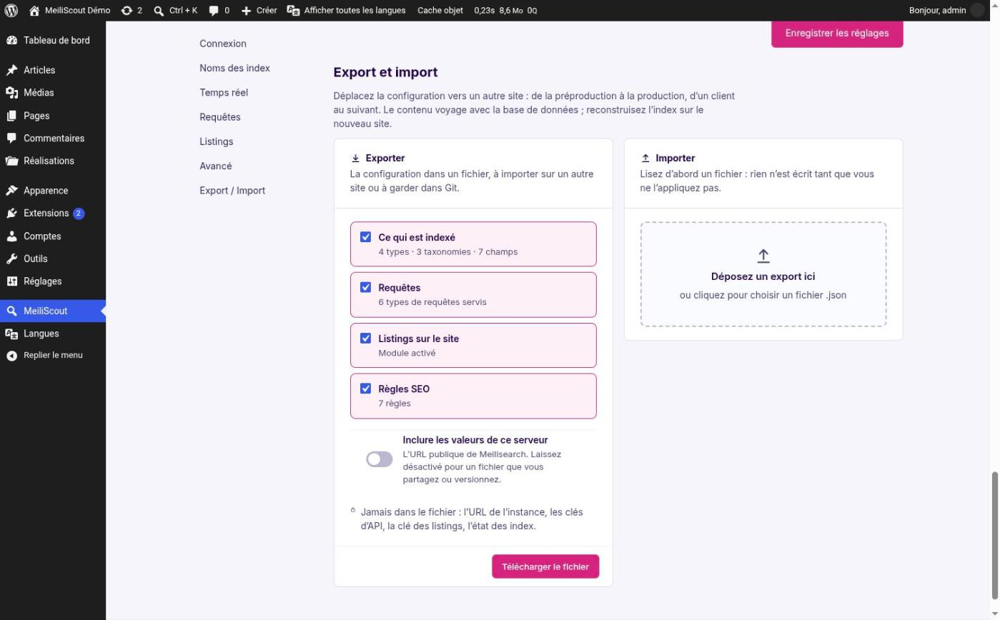

### Export

Tick the sections the file should hold, then **Download the file** (`meiliscout-<site>-<date>.json`).

| Section | What it holds |
|---|---|
| **What is indexed** | The post types, taxonomies, custom fields and term fields indexed; whether private content is; the fields searched, in order; the real-time mode; the size of an indexation's pages and batches |
| **Queries** | The kinds of queries Meilisearch serves, the maximum results per query, the timeout |
| **Front listings** | The module's switch, the default styles and their colours |
| **SEO rules** | The rules of the listings, as the same CSV the SEO rules screen exports |

A section the site cannot serve (SEO rules while the listings are off) is greyed out, with the reason.

**Never in the file**, whatever you tick: the instance URL, the API keys, the listings key, the state of the indexes. The file only holds what an allow-list names, and the export stops if a setting whose name looks like a key, a token or a password ever slips into it. The one value tied to a server, **the public URL of Meilisearch**, is left out unless you switch on *Include the values of this server*.

### Import

Drop a file on the zone (or click it). **Reading it writes nothing**: MeiliScout compares it with the site and shows what would change.

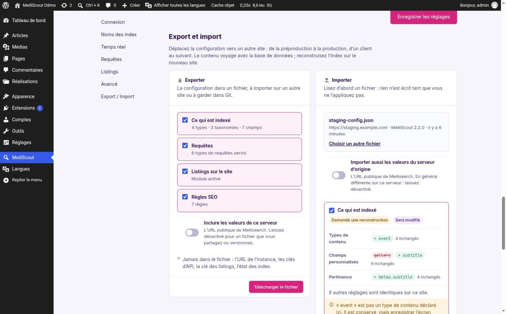

For each section the screen shows:

- a **status**: *Will change*, *Same as here*, *Cannot import* (the file has an error: nothing of that section is written) or *Skipped*;
- the **changes**: values added (green `+`), removed (struck through red), a switch going from one state to another, a number from one value to another, and how many other settings already match;
- **warnings** in amber, for what is kept or left out. For instance a post type the site does not register (the plugin that registers it may not be active yet): it is kept, but saving the Content screen would drop it until it is registered;
- a pill **Needs a rebuild** when what is indexed or searched changes.

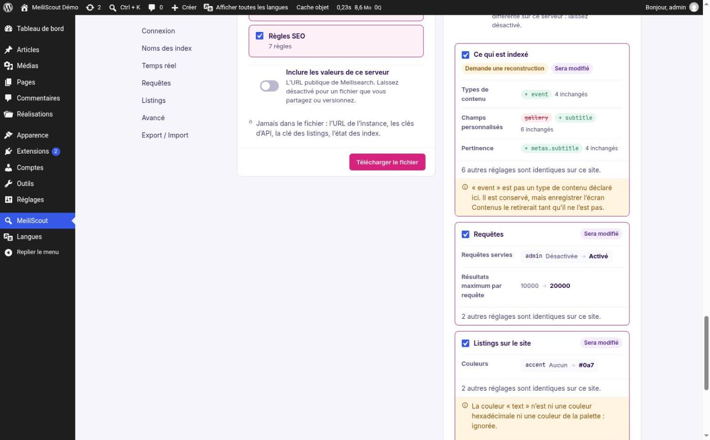

Untick a section to leave it out, then **Import N sections**. The import **never rebuilds the index itself**: when a section needs it, the screen says so and links to *Indexation*.

What protects the site:

- only the settings a section names are read; anything else in the file is reported and ignored;
- a value of the wrong type is an error, not a guess;
- a field to search that depends on a custom field is kept only if the file indexes that custom field too;
- a real-time mode forced by `MEILISCOUT_ASYNC_INDEXING` is not changed;
- turning the listings on needs WordPress 6.9: on an older one the switch is left as it is;
- what is applied is the file that was previewed (the browser sends back a token, valid for 15 minutes, not the file), planned again on the site as it is at that moment.

### WP-CLI

The same operations, for a deploy script:

```bash
wp meiliscout export meiliscout.json                      # all the sections; without a file name, to stdout
wp meiliscout export --sections=indexing,queries          # some of them (indexing, queries, listings, seo_rules)
wp meiliscout export --include-env                        # with the public URL of Meilisearch

wp meiliscout import meiliscout.json                      # a DRY RUN: shows what would change, writes nothing
wp meiliscout import meiliscout.json --apply              # writes it
wp meiliscout import meiliscout.json --only=queries       # only some sections of the file
wp meiliscout import meiliscout.json --strict --apply     # a warning is a refusal (exit 1)
wp meiliscout import meiliscout.json --apply --reindex    # then a full indexation, if the index is out of date
```

`import` without `--apply` is always a dry run. It exits with an error (and writes nothing) when the file has errors, or with `--strict` when it raised warnings.

### What does not travel

The listings declared in PHP (they are in the theme's code); the listings built with blocks (their definition is saved with the post, and travels with the content); the languages (Polylang and WPML have their own tools); the documents of the indexes (rebuild them on the target). Synonyms, stop words and ranking rules are not managed by the plugin, so they are not part of the file.

A plugin can add its own section with the `meiliscout/config_sections` filter.

---

## 12. Deploying to another server

A site's content moves with its database. What does **not** move by itself is the index: Meilisearch is a separate service.

1. Set the connection on the new server (environment variables, [section 10](#10-configuration-by-environment)), with its **own prefix** if the instance is shared.
2. Check **Content**: the post types, taxonomies and custom fields are options of the database, so they come with it. If you started from a fresh database, import the configuration file of the other site.
3. Run a **full indexation** (`wp meiliscout index`). Never copy an index from one server to another: the document format and the active-index records are local.
4. If the listings module is on, the **listings key** of the new server is its own: do not copy it; if the pages were cached with tokens of another key, replace it from Settings › Listings.
5. Run `wp meiliscout check-queries` and, with listings, `wp meiliscout check-listings`.

The configuration itself (what is indexed, the queries served, the listings' settings, the SEO rules) can be exported and imported: see [section 11](#11-export-and-import-the-configuration).

---

## 13. Troubleshooting

| Symptom | Likely cause and what to do |
|---|---|
| The header says it cannot connect | Wrong instance URL (from the server: `http://meilisearch:7700` in Docker is not reachable from your browser, but must be from PHP), wrong key, or a firewall. Use **Test the connection** |
| A search returns nothing | The index is empty or out of date: run an indexation. Check the post type is switched on in Content |
| A query is not served by Meilisearch | Open the Overview's *MySQL fallbacks*: the reason names the cause (`unindexed_meta:price`: add the field; `unsupported_arg:…`: see WP_QUERY.md) |
| After adding a field, filtering on it does nothing | The index structure changed: run a **Rebuild** |
| Listings show no counts, or the browser console says a token was refused | Browsers cannot reach Meilisearch (fill *Public URL of Meilisearch*), or the listings key was replaced and a cached page still carries an old token |
| A field is locked in Settings | Its value comes from the environment or a constant: change it there, not in the admin |
| Real-time updates do not appear | The mode is *Off*, or *Async queue* and WP-Cron is not running; see the log in Indexation |
