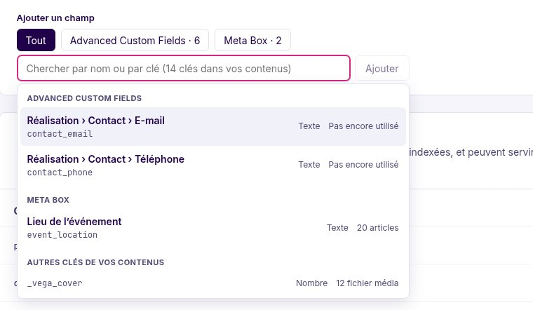
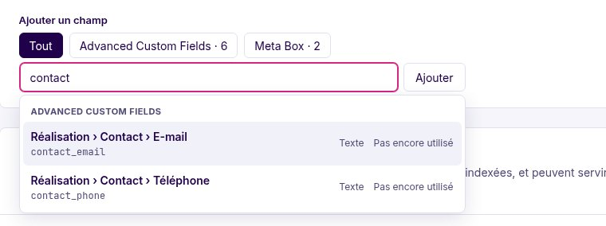

# Custom fields, by name

A custom field is stored under a **meta key**: `client_sector`, `_price`, `contact_email`. Plugins that declare fields know them by a **name** (“Project › Client sector”, “WooCommerce › Price”). MeiliScout shows that name wherever you pick, index or read a field, and keeps the key next to it. Nothing about indexing changes: a field is still indexed, filtered, sorted and searched under its meta key (`metas.<key>` in the documents).

Names come from **ACF** (and Secure Custom Fields), **Meta Box**, **WooCommerce**, and from anything your theme or a plugin declares ([below](#declaring-your-own)).

## Picking the fields to index

In **MeiliScout › Content › Custom fields**, *Add a field* searches **by name or by key**:



- **Named fields come first**, under a heading per source (Advanced Custom Fields, Meta Box, WooCommerce…). Each shows its name, its key under it, the type it stores, and how many contents have it (*Not used yet* for a field no content has a value for).
- **Then the raw keys** found in your content that no plugin names, under *Other keys in your content*. WordPress's own bookkeeping keys (`_wp_*`, `_edit_*`, `_thumbnail_id`…) and the references ACF stores next to its fields (`_client_sector`) are not suggested; you can still type one and press *Add*.
- **The chips above the field** narrow the search to one source (*Advanced Custom Fields · 6*). A source only appears when it has fields on the post types you index.
- **The list is never complete.** At most 20 are listed, with “N more: keep typing to narrow it down”. A site with thousands of keys never loads them all: you search for what you need.



A field that is selected is shown with its name, its key and its source:


The type shown is the one the plugin that declares the field knows (a flag stored as `0` and `1` is a yes / no, not a number); for a field no plugin names, it is guessed from the values.

## Where names show

| Screen | What shows the name |
|---|---|
| Content › Custom fields | The selected fields and the picker |
| Content › Relevance | The fields searched (a field is searchable once it is indexed) |
| Listings | A facet on a custom field shows the field's name under its source (`meta:client_sector`). With no `label`, the facet is labelled with the field's **short name** (“Client sector”) instead of its key |

## Sources

### Advanced Custom Fields

The fields of every field group, as `Group title › Field`; a field inside a **group field** is stored as `group_field` and named `Group title › Group › Field`. A field is offered on the post types its group is shown on (its *Location* rules); a group shown only on options pages, users or terms offers nothing. **Left out for now:** repeaters and flexible content (they store one key per row, which one meta key cannot name), clones, links, and layout fields (tabs, messages). The values indexed are the stored ones, not ACF's formatted ones.

### Meta Box

Every field of every meta box, by its name, on the post types of its meta box. **Left out:** fields kept in a custom table (they have no meta key), groups, headings, buttons and other fields that store nothing.

### WooCommerce

A fixed list of the product keys stores and themes search and filter on: price, regular price, sale price, SKU, stock quantity and status, manage stock, units sold (`total_sales`), average rating, review count, virtual, downloadable, weight, length, width, height. On the `product` post type.

## Declaring your own

```php
// functions.php, or a plugin
meiliscout_register_meta_field('budget', [
    'label'      => 'Project › Budget', // what the admin calls it
    'group'      => 'Studio',           // the heading in lists
    'type'       => 'number',           // number, date, boolean, list, text; omit to guess from the values
    'post_types' => ['project'],        // omit when any
]);
```

Declared at any time; it wins over a plugin's name for the same key.

The filter `meiliscout/meta_fields` receives every named field (the providers' and the declared ones) as `MetaField` instances and may add, rename or remove some; an array with `key`, `label`, `group`, `source`, `type` and `post_types` works too:

```php
add_filter('meiliscout/meta_fields', function (array $fields) {
    $fields[] = ['key' => 'seo_title', 'label' => 'SEO › Title', 'group' => 'SEO', 'source' => 'seo'];

    return $fields;
});
```

To support a whole plugin, implement `Pollora\MeiliScout\Fields\FieldProvider` (`available()` says whether its plugin is there, `fields()` returns `MetaField` instances) and add it with `meiliscout/meta_field_providers`. A provider that throws is skipped and logged: a broken plugin does not take the admin down.

## What does not change

- The field is indexed under its **meta key**: `meta_query`, sorting, facets (`'source' => 'meta:client_sector'`) and `public_metas` use the key, as before.
- Existing selections keep working; names are added to them, nothing is renamed.
- Visitors never run any of this: the registry is read by the admin, never by a front request.
