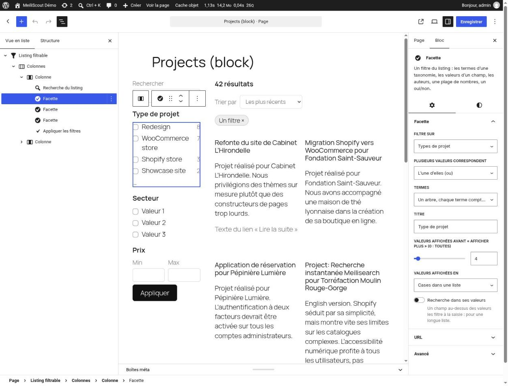
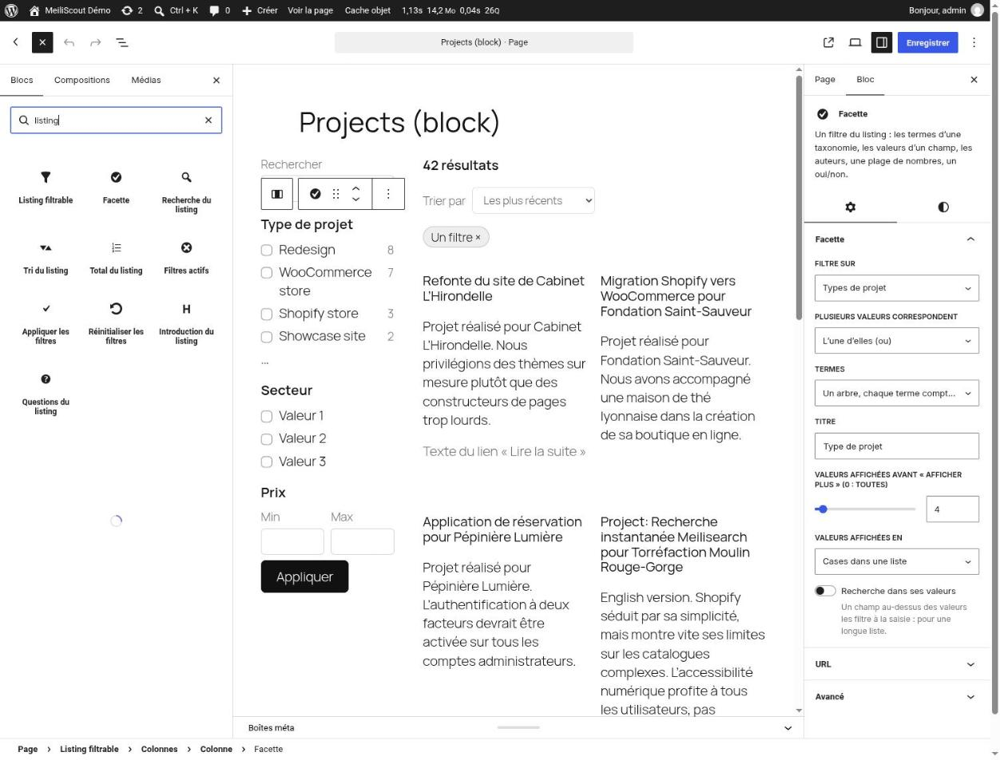
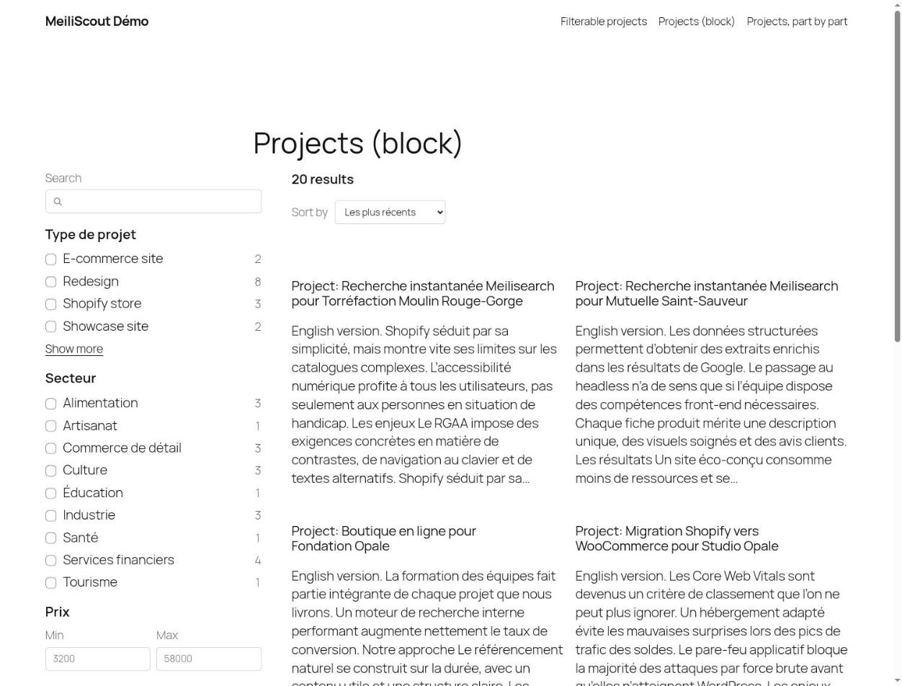
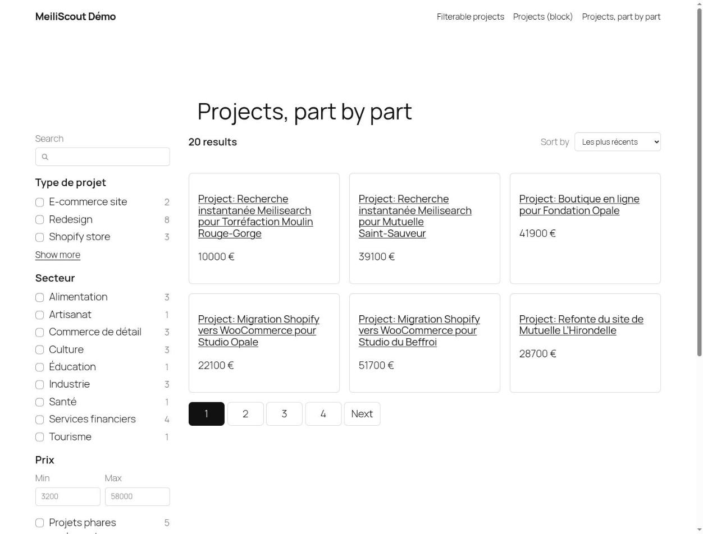
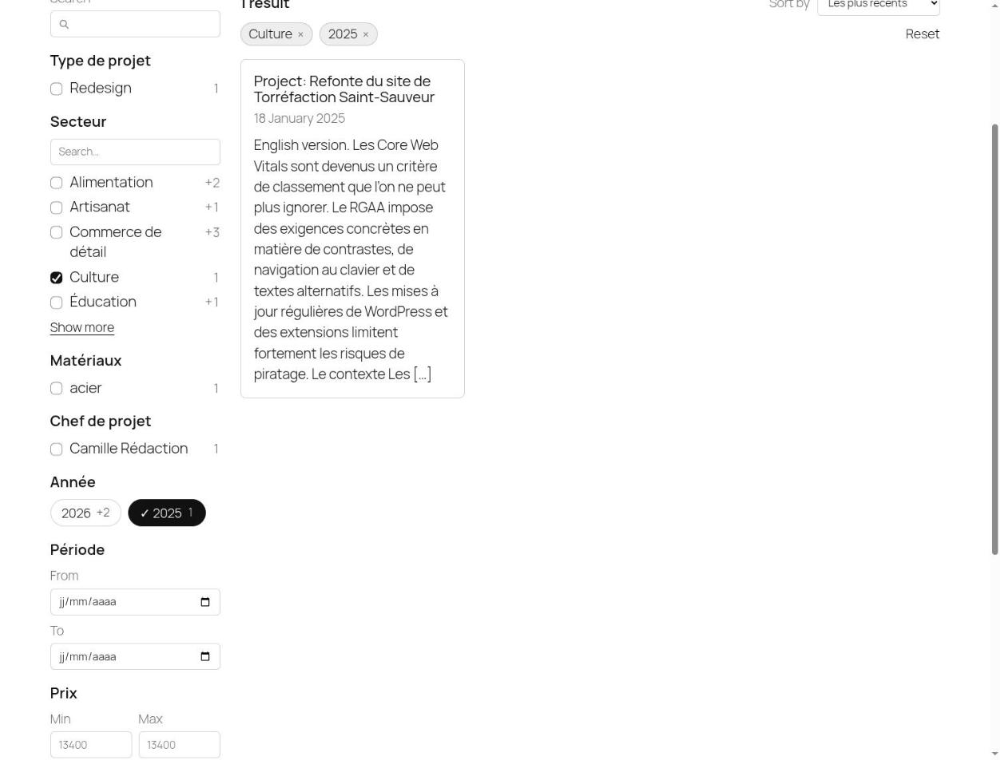

# Building a filterable listing: a step-by-step guide

This guide walks you through building a search listing (facets, counts, sort, search, pagination) in the two ways MeiliScout offers:

- **[Editor mode](#2-editor-mode-in-the-block-editor)**: you assemble it in the block editor, with no code.
- **[Developer mode](#3-developer-mode-in-code)**: you declare it in PHP and print it, whole or part by part, from a PHP template, **Blade** or **Twig**.

Both produce the same listing, with the same URLs, the same SEO and the same behavior. For the complete reference of every option, see [LISTINGS.md](LISTINGS.md); this page is the tutorial that gets you there.

| | |
|---|---|
|  | A listing on a wide screen: the search and the facets on the left, the total and the sort above the cards, pagination under them. The look comes from the theme (fonts, colors, spacing); see [Styling](#5-styling). |

## Contents

1. [Before you start](#1-before-you-start)
2. [Editor mode: in the block editor](#2-editor-mode-in-the-block-editor)
3. [Developer mode: in code](#3-developer-mode-in-code)
   - [Declare the listing](#31-declare-the-listing)
   - [Print it whole](#32-print-it-whole)
   - [Print it part by part](#33-print-it-part-by-part)
   - [With Blade](#34-with-blade)
   - [With Twig](#35-with-twig-timber)
   - [Your own cards](#36-your-own-cards)
4. [The facets](#4-the-facets)
5. [Styling](#5-styling)
6. [Small screens](#6-small-screens)
7. [URLs and SEO in a nutshell](#7-urls-and-seo-in-a-nutshell)
8. [Checking your work](#8-checking-your-work)
9. [Troubleshooting](#9-troubleshooting)

---

## 1. Before you start

You need:

1. **WordPress 6.9 or later** (the listing relies on the Interactivity API's router).
2. **MeiliScout connected to Meilisearch**, with the content you want to list **indexed** (MeiliScout › Indexation). Listings need the posts index in schema 5: if `wp meiliscout status` says otherwise, run a full indexation.
3. **The module turned on**: MeiliScout › Settings › **Listings** › *Front listings*. It is off by default and loads no script or style on a page without a listing.
4. **What you filter on must be indexed**: the post type (MeiliScout › Content › Post types) and any custom field you want as a facet (Content › Meta keys). Taxonomies and authors are indexed with the posts.
5. If browsers cannot reach Meilisearch at the URL the server uses (for example `http://meilisearch:7700` in Docker), fill **Public URL of Meilisearch** on the same screen.

Facets are counted by the visitor's browser straight on Meilisearch, with a token that can only search the listing's posts, so the counts update instantly without going through PHP. Without JavaScript the filters are a plain `GET` form and the pages are real links: everything still works.

---

## 2. Editor mode: in the block editor

Use this when an editor, not a developer, builds or changes the page.

### 2.1 Insert the block

In a page, a post or a template (site editor), insert **Filterable listing**. It starts with:

- a narrow column with a **search** field, one **Facet** and an **Apply** button;
- a wide column with the **total**, the **active filters**, the core **Post Template** (the cards) and the core **pagination**.

These are the core's own blocks, so the cards, the pagination and the layout are styled and arranged as anywhere else in the editor: change the Post Template's layout (grid, list), put an image, a date or a custom field in each card, as in any Query Loop.


*Screenshots of the editor are from a site whose admin language is French.*

### 2.2 Set up the listing (the block's settings)

Select the **Filterable listing** block and open its settings:

- **Content types**: which post types it lists (the indexed ones).
- **Items per page**.
- **Filters apply**: *At once* (a change updates the results immediately) or with a button (a change only updates the counts, and the button says *See N results*).
- **Results change**: *In place* (no page load) or by loading the page.
- **Sorts**: the choices offered in the sort menu.

If the listing cannot be served (a field that is not indexed, a reserved URL name...), the editor says why, right in the block.

### 2.3 Add and configure facets

Insert **Facet** blocks anywhere inside the listing, for example one per column section, or a few in the sidebar. For each one, pick:

| Setting | What it does |
|---|---|
| **Filters on** | A taxonomy of the chosen types, the authors, an indexed field, or the **year of publication** / **of the last update** |
| **Kind** | A list of values, a range (numbers, or **a range of dates**), or a yes/no |
| **Several values match** | *Any* (each value widens the results) or *all* (each value narrows them) |
| **Title** | The facet's heading |
| **Values shown as** | Boxes in a list, or pills (**chips**) |
| **Values shown before “Show more”** | Folds long lists (0: all) |
| **Search in its values** | A small search field above a long list (clients, brands, tags...) |
| **URL** | Its name in the URL (*Name in the URL*), and whether a taxonomy facet goes in the **path** (*In the path*) (`/projects/type-redesign/`) |

The facets' order in the document is their order in the URL. Block supports (colors, typography, spacing, border) apply to each facet.



The list view (left) shows the structure the block creates: the listing, its columns, then the search, the facets and the apply button on one side, the results on the other.

### 2.4 Rearrange with the "Listing part" blocks

Each element of the listing is also available on its own as a **Listing part** block, so you can move it anywhere inside the listing: *Listing search*, *Listing sort*, *Listing total*, *Active filters*, *Apply filters*, *Reset filters*, and, when you use SEO rules, *Listing introduction* and *Listing questions*.

For example, to put the sort next to the total at the top of the results, drag the *Listing sort* block beside the *Listing total*.

Searching the inserter for “listing” lists every block of the module: **Filterable listing**, **Facet**, and the **Listing part** blocks.





### 2.5 Good to know

- The listing's definition is saved with the post (or template) automatically.
- A listing inside a page uses that page as its route: its URLs are `/that-page/…`. In a template, it uses the current URL.
- The Post Template's query **is** the listing's query, and the core pagination's links are the listing's canonical URLs, loaded in place.
- The editor warns you if a block inside the Post Template would force the whole page to reload when results change (blocks that do not declare `interactivity.clientNavigation`).
- Not available in this mode: the client transport (cards made in the browser) and a Post Template that inherits the main query of an archive. For these, use [developer mode](#3-developer-mode-in-code).

---

## 3. Developer mode: in code

Use this when the listing is part of a theme or a plugin, or when you need full control over the markup.

### 3.1 Declare the listing

On `init` (or earlier), in the theme or a plugin:

```php
add_action('init', function () {
    meiliscout_register_listing('projects', [
        'post_types' => ['project'],
        'per_page'   => 12,
        'route'      => ['page' => 42],            // the page that shows the listing (see "URLs")
        'facets'     => [
            'type'   => ['source' => 'taxonomy:project_type', 'label' => 'Type', 'limit' => 6],
            'sector' => ['source' => 'meta:client_sector', 'label' => 'Sector', 'search' => true],
            'year'   => ['source' => 'date', 'label' => 'Year', 'display' => 'chips'],
            'price'  => ['source' => 'meta:_price', 'type' => 'range', 'label' => 'Price'],
        ],
        'sorts' => [
            'recent' => ['label' => 'Newest first', 'orderby' => 'date', 'order' => 'DESC'],
            'price'  => ['label' => 'Lowest price', 'orderby' => 'meta_value_num', 'meta_key' => '_price', 'order' => 'ASC'],
        ],
    ]);
});
```

The first argument is the listing's **id**, used everywhere below. A listing is checked the first time it is used: if it cannot be served (an unindexed post type or meta key, a reserved parameter...), visitors see nothing and **administrators see the list of errors** in place, in Settings › Listings and in MeiliScout › Listings.

The main options: `post_types`, `per_page`, `facets`, `sorts`, `route`, `apply` (`instant` or `button`), `transport` (`fragment`, `client`, `page`), `card`. Everything is documented in [LISTINGS.md › Arguments](LISTINGS.md#arguments).

### 3.2 Print it whole

Wherever the listing goes: a page template, a shortcode of your own, a block render callback.

```php
<?php meiliscout_listing('projects'); ?>           <?php // prints it ?>

<?php $html = meiliscout_get_listing('projects'); ?> <?php // returns it ?>
```

That is the full layout: filters in a column (a sheet on small screens), the total, the sort, the active filters and the results in the other. Also note that the listing's state is printed by `wp_footer()`: **the template must call `wp_footer()`**, otherwise the listing does not react (with `WP_DEBUG` on, MeiliScout reports it).


### 3.3 Print it part by part

When the design is yours (a sidebar here, a toolbar there), print each part where you want it, in any order:

```php
<aside class="filters">
    <?php meiliscout_listing_part('projects', 'search'); ?>
    <?php meiliscout_facet('projects', 'type'); ?>
    <?php meiliscout_facet('projects', 'price'); ?>
    <?php meiliscout_listing_part('projects', 'apply'); ?>
</aside>

<main>
    <?php meiliscout_listing_part('projects', 'total'); ?>
    <?php meiliscout_listing_part('projects', 'sort'); ?>
    <?php meiliscout_active_filters('projects'); ?>
    <?php meiliscout_listing_results('projects'); ?>
    <?php meiliscout_pagination('projects'); ?>
</main>
```

The parts: `search`, `facet` (one: `meiliscout_facet($id, $key)`), `facets` (all of them), `sort`, `total`, `active`, `apply`, `reset`, `results`, `pagination`, and for [SEO rules](LISTINGS.md#seo-rules) `intro` and `faq`. Each also has a `meiliscout_get_listing_part()` twin that returns the HTML instead of printing it.

The listing runs once per page, however many parts you print, and every field belongs to the listing's single form, wherever it sits. Print the `apply` part so a visitor without JavaScript can send the form.



### 3.4 With Blade

On a site running Laravel's Blade (Pollora, Acorn), MeiliScout registers anonymous components on `init`:

```blade
{{-- the whole listing --}}
<x-meiliscout::listing id="projects" />

{{-- or part by part --}}
<div class="grid grid-cols-[18rem_1fr] gap-8">
    <aside>
        <x-meiliscout::part listing="projects" part="search" />
        <x-meiliscout::facet listing="projects" facet="type" />
        <x-meiliscout::facet listing="projects" facet="price" />
        <x-meiliscout::part listing="projects" part="apply" />
    </aside>
    <main>
        <x-meiliscout::part listing="projects" part="total" />
        <x-meiliscout::part listing="projects" part="sort" />
        <x-meiliscout::active-filters listing="projects" />
        <x-meiliscout::results listing="projects" />
        <x-meiliscout::pagination listing="projects" />
    </main>
</div>
```

Another Blade compiler: call `Pollora\MeiliScout\Listings\Template\Blade::register($compiler)`. A Blade view can also be the **card** of the listing, see [Your own cards](#36-your-own-cards).

### 3.5 With Twig (Timber)

With Timber, the functions are added to its environment. Their HTML is not escaped.

```twig
{{ meiliscout_listing('projects') }}

<aside>
  {{ meiliscout_listing_part('projects', 'search') }}
  {{ meiliscout_facet('projects', 'type') }}
  {{ meiliscout_listing_part('projects', 'apply') }}
</aside>
<main>
  {{ meiliscout_listing_part('projects', 'total') }}
  {{ meiliscout_listing_part('projects', 'sort') }}
  {{ meiliscout_active_filters('projects') }}
  {{ meiliscout_listing_results('projects') }}
  {{ meiliscout_pagination('projects') }}
</main>
```

With another Twig environment: `$twig->addExtension(new Pollora\MeiliScout\Listings\Template\TwigExtension)`.

### 3.6 Your own cards

The card is part of the listing's definition, so the page and the fragments the browser asks for render the same markup. Pick the form that suits your stack:

```php
'card' => fn (WP_Post $post) => '<h3>'.esc_html(get_the_title($post)).'</h3>',  // a closure
'card' => 'partials/project-card',          // a theme template part (gets $args['post'])
'card' => 'blade:partials.project-card',    // a Blade view, with $post and $listing
'card' => 'twig:partials/project-card.twig',// a Twig template, with post (Timber's) and listing
'card' => new ProjectCards,                 // a Pollora\MeiliScout\Listings\Render\CardRenderer
```

Without a `card`, MeiliScout uses your theme's `meiliscout/card.php` if there is one, else a title, a date and an excerpt. A Blade card, for example:

```blade
{{-- resources/views/partials/project-card.blade.php --}}
<article class="meiliscout-card">
    <h3 class="meiliscout-card__title"><a href="{{ get_permalink($post) }}">{{ get_the_title($post) }}</a></h3>
    <p class="meiliscout-card__meta">{{ get_post_meta($post->ID, '_price', true) }} €</p>
</article>
```

Keep the `meiliscout-card` classes if you want the kit's look; use your own if you style the cards yourself.

**Cards made in the browser (`'transport' => 'client'`)**: one request to Meilisearch gives both the counts and the documents, with no PHP involved. The card is then a small piece of markup bound to the document's fields with Interactivity directives, from the fields you declare public:

```php
'transport'    => 'client',
'public_metas' => ['_price', 'client_sector'],
'client_card'  => '<article class="meiliscout-card">
    <h3><a data-wp-bind--href="context.hit.url" data-wp-text="context.hit.title"></a></h3>
    <p><time data-wp-bind--datetime="context.hit.date" data-wp-text="context.hit.dateLabel"></time>
       · <span data-wp-text="context.hit.metas.client_sector"></span></p>
</article>',
```

The fields available (`title`, `url`, `date`, `dateLabel`, `excerpt`, `terms.<taxonomy>`, `metas.<key>`) are in [LISTINGS.md › The client transport's card](LISTINGS.md#the-client-transports-card). Everything is text: bind it with `data-wp-text`, never as HTML.

---

## 4. The facets

The same facet kinds exist in both modes (a **Facet** block's *Filters on* and *Kind* map to `source` and `type`):

| You want | `source` | `type` | Notes |
|---|---|---|---|
| Terms of a taxonomy | `taxonomy:project_type` | `list` | A hierarchical taxonomy shows as a tree; each term is counted with its descendants |
| Values of a custom field | `meta:client_sector` | `list` | The key must be indexed (Content › Meta keys) |
| A price or a number | `meta:_price` | `range` | Two fields, min and max (`decimals` for the precision) |
| A yes/no | `meta:featured` | `boolean` | One checkbox |
| The authors | `author` | `list` | Slugs in the URL, names on the page |
| The years | `date` (or `date:modified`) | `list` | Newest first, a post has one date so values combine with *or* |
| A period | `date` | `range` | Two date fields, `?period=2025-03-01..2025-06-30` |

Options worth knowing:

- **`logic`**: `or` (default: each value widens the results) or `and` (each value narrows them, for example required materials).
- **`display` => `chips`**: values as pills, a ticked one reads with a tick. The same checkboxes stay underneath, so it works without JavaScript.
- **`limit`**: past that many values, the rest fold behind *Show more*. A selected value never folds.
- **`search` => true**: a search field in a long list of values.
- **`path`**: a taxonomy facet's values go in the path rather than in the query string: `/projects/type-redesign,shop/`.

Once a filter is selected, the other values of an *or* list show what they would add (`+3`), and the active filters appear as removable pills above the results:



The full list of options: [LISTINGS.md › Arguments](LISTINGS.md#arguments).

---

## 5. Styling

By default the listing ships a small **UI kit** that **follows your theme**: it inherits fonts, sizes and colors, reads the `theme.json` presets when there are some, and uses `currentColor` and the system colors otherwise. The look is declared under `:where()` (no specificity), so any rule of your theme wins over it. A dark section of the theme gets a dark listing.

Change the look with a few CSS variables, on the listing or any ancestor:

```css
.my-theme {
	--meiliscout-color-accent: #0a7;
	--meiliscout-color-accent-contrast: #fff;
	--meiliscout-border-radius: 0;
	--meiliscout-spacing: 1.25rem;
	--meiliscout-max-width: 72rem;   /* the listing's width (the theme's wide size by default) */
}
```

The accent can also be chosen in **Settings › Listings**, from the theme's palette or a color of your own. Other tokens (text, muted, background, border, control height, shadow...) are in [LISTINGS.md › UI kit](LISTINGS.md#ui-kit).

To style everything yourself, switch **Default styles** off (Settings › Listings) and use the markup's classes (`.meiliscout-listing`, `.meiliscout-facet`, `.meiliscout-card`, `.meiliscout-pagination`...), outlined in [LISTINGS.md › Markup](LISTINGS.md#markup). A specimen of every component and state, rendered in your theme, is at `/?meiliscout-ui-kit` for administrators while `WP_DEBUG` is on.

In code mode, a listing printed from PHP loads its stylesheet in the footer; to have it in the `<head>`, enqueue `meiliscout-listings` on `wp_enqueue_scripts`. The blocks load it in the `<head>` themselves.

---

## 6. Small screens

Below 782 px, the listing's search and facets go behind a **Filters (n)** button, where *n* is the number of selected filters, and open as a sheet. Its footer holds **See N results** (the live count when filters apply with a button, or a simple close button when they apply at once). On a wide screen nothing changes: the filters stay in their column. Without JavaScript the filters stay on the page.


This panel is built into the whole listing (`meiliscout_listing()` and the editor's default layout). When you place the parts yourself (developer mode, part by part) or arrange the blocks by hand, you choose where the filters go; a developer can reuse the same sheet with `Renderer::panel()`.

---

## 7. URLs and SEO in a nutshell

You get these without extra work:

- **One canonical URL per state**: `/projects/page/2/?sector=Culture&price=1000..5000&sort=price&q=shop`. A form sent without JavaScript, another order of values and so on is redirected (301) to it, so every filtered view can be shared and bookmarked.
- **A `route`** is what makes this possible: in code, `'route' => ['page' => 42]` (a page) or `['archive' => 'project']`. In the editor, the page holding the block is the route.
- **Facets in the path**: a facet with `path` gives readable, indexable URLs (`/projects/type-redesign/`) with no rewrite rule to flush.
- **Search engines**: a listing's page says what may be indexed (the listing, and views of one or two path facets with enough results), with its canonical, adjacent pages and structured data; `noindex, follow` elsewhere. It is written through Yoast SEO, Rank Math, SEOPress, All in One SEO, or WordPress alone.
- **SEO rules** (MeiliScout › SEO rules) give a view its own title, description, heading, introduction and questions; they show through the `intro` and `faq` parts or blocks.
- **Languages**: Polylang and WPML are supported (counts, routes and prefixes per language).

Details: [LISTINGS.md › URLs](LISTINGS.md#urls), [SEO](LISTINGS.md#seo), [Languages](LISTINGS.md#languages).

---

## 8. Checking your work

- **MeiliScout › Listings** shows each declared listing (from PHP or a block): its address in each language, its facets, its checks (unindexed sources, a route without a page, two listings on a page...) and its counts compared with MySQL.
- From the command line:

  ```bash
  wp meiliscout check-listings                  # checks, counts against MySQL, URLs over HTTP
  wp meiliscout check-listings --listing=projects --skip-http
  wp meiliscout bench-listings projects         # timings of the page, fragment and counts
  ```

- A listing that cannot be served says why to administrators, at the place it should be.

---

## 9. Troubleshooting

| Symptom | Likely cause |
|---|---|
| Nothing prints | The module is off (Settings › Listings), or the definition has errors: look at the message shown to administrators |
| The listing shows but does not react | The template does not call `wp_footer()`; or browsers cannot reach Meilisearch (fill *Public URL of Meilisearch*) |
| A facet is missing or empty | The field is not indexed (Content › Meta keys), the facet has no value in the current selection (it is hidden), or the posts index needs a full indexation |
| Counts but no cards update / the whole page reloads | A block in the Post Template (editor mode) that does not declare `interactivity.clientNavigation`, or `transport` set to `page` |
| A URL parameter is refused | The name is one WordPress, WooCommerce or a cache reads (`p`, `page`, `orderby`, `utm_*`...): set `param` to another |
| The editor says a field is not indexed | Add the post type or meta key to the index, then run a full indexation |
| The default look clashes with the theme | Set the `--meiliscout-color-*` variables, or turn *Default styles* off and style the classes yourself |

More: [LISTINGS.md](LISTINGS.md), and for the queries behind the results, [WP_QUERY.md](WP_QUERY.md).
