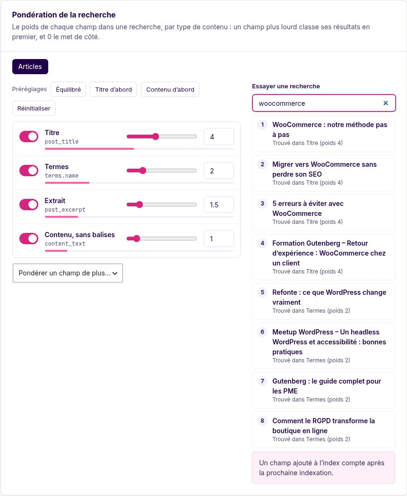

# Search weights

A step-by-step tutorial, with screenshots, is in [WEIGHTS_GUIDE.md](WEIGHTS_GUIDE.md); this page is the reference.

A search looks into several fields of a post: its title, its terms, its excerpt, its content, and the custom fields you index. **Weights** say how much each one counts, per post type, as ElasticPress does: a match in a field with a higher weight ranks the post higher.



## Setting weights

**MeiliScout › Content › Search weights.** One tab per indexed post type; for each field:

- the **switch** puts the field in or out of the search (a weight of 0 leaves it out);
- the **slider** and the **number** set its weight, from 0 to 10 by halves;
- the **bar** under it shows its share of the total.

*Balanced*, *Title first* and *Content heavy* are presets; *Reset* restores the defaults. *Weigh one more field* adds a field that is not listed (the slug, the raw HTML of the content, or a custom field you [index](FIELDS.md): shown under its name).

On the right, **Try a search** runs a query for the post type with the weights **as they are on screen, saved or not**, and tells what ranked each result: *Found in Title (weight 4)*. Move a slider and the ranking changes before you save.

Until you save weights, every type is searched with the defaults: title 4, terms 2, excerpt 1.5, content 1.

## How it works

Meilisearch orders the fields of an index but has no weight per field. MeiliScout makes real weights at search time with Meilisearch's **federated search**: the fields that weigh the same are one query, each query is limited to its fields (`attributesToSearchOn`) and multiplied by its weight, and Meilisearch merges them into one list, a post found by several queries appearing once with its best score. It is one HTTP call; on the demo (344 posts) four weights cost about 2 ms more than a plain search.

- **Only a search by relevance is weighted:** a search term, no explicit sort (`orderby`), no facets. Anything else is the search it was.
- **One weight for all fields** of a type is a plain search: there is nothing to merge.
- A field with a weight of **0 is not searched**, in the results and in their count, so the number of results agrees with the list.
- The index's searchable attributes become the fields some type weighs, heaviest first. A field that is not in the index yet counts after the next indexation (the Content screen says when one is needed).
- If Meilisearch refuses the weighted search, the query is searched without weights and the error is logged.

## In code

```php
// What a type is searched with: field => weight (0 leaves it out)
add_filter('meiliscout/search_weights', function (array $weights, string $type) {
    if ($type === 'product') {
        $weights['metas._sku'] = 8;
    }

    return $weights;
}, 10, 2);
```

`$query->meiliscout['weighted']` tells how many weight tiers a `WP_Query` search used (absent when it was not weighted). The weights travel with the configuration export (`search_weights`).

## Limits

Weights apply to WordPress searches (`WP_Query`, the site search, the REST API) and to the **suggestion fields**.

- **Suggestions**: a source of posts sends one search per weight (limited to that weight's fields, and to the post types that have it) and the browser merges them: a post found by several counts once, for its best `weight × ranking score`, and the source keeps its limit. They go in the same multi-search request, so there is no extra round trip. The terms sources are not weighted. The plan's `version` is 2 for it (`Suggest\Render\Plan::searches()`, `mergeHits()` in `resources/suggest/client.js`).
- **Front listings** order their results by one of their own sorts (date, title, a meta key...), never by relevance, so weights have nothing to rank there. A listing's search only looks in the fields that are switched on (the index searches those and no other).
