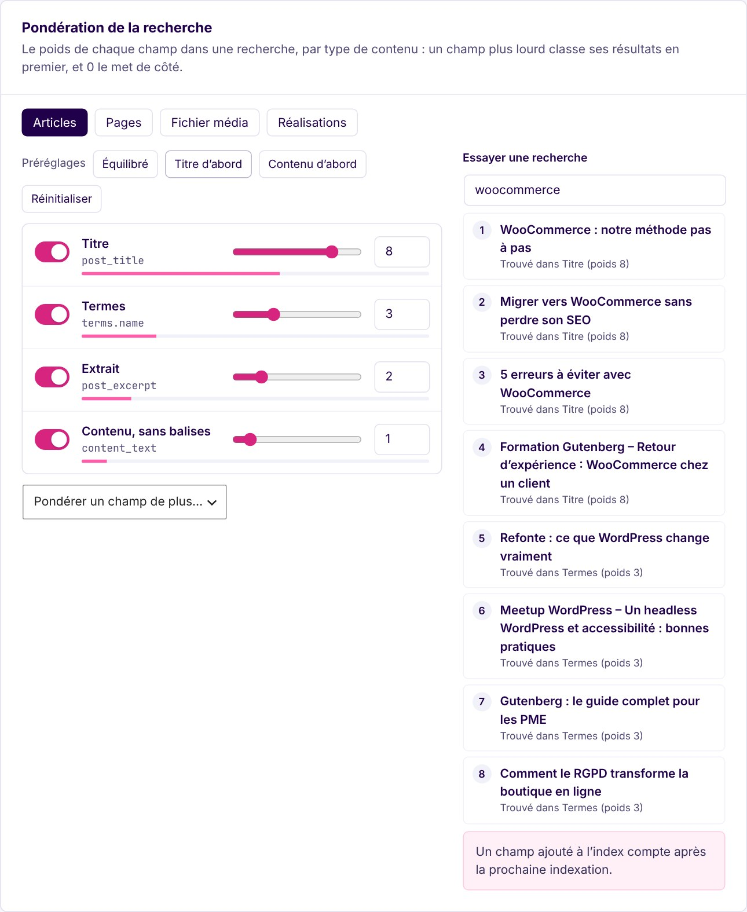
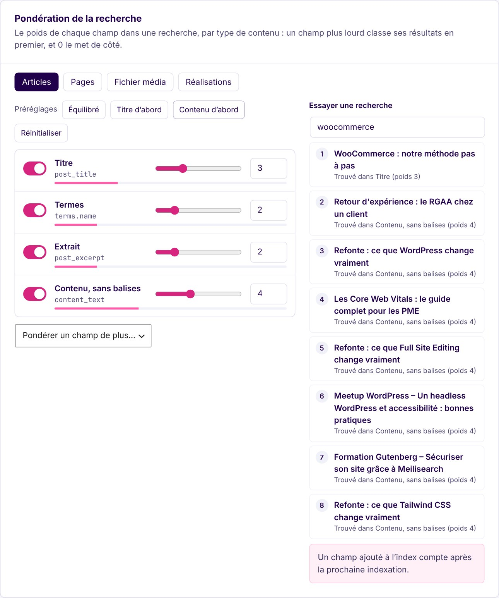
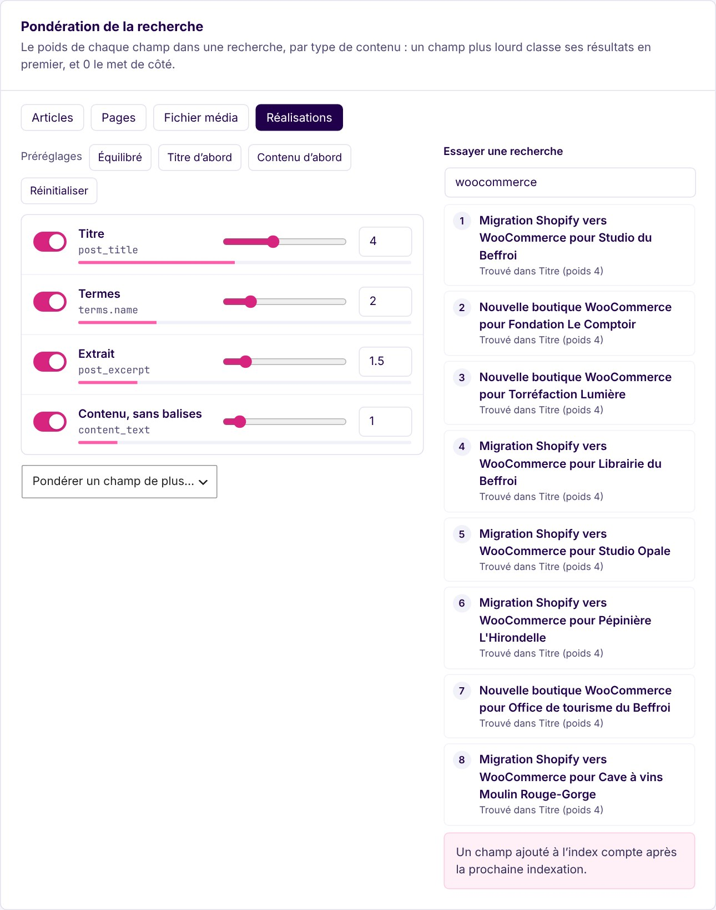
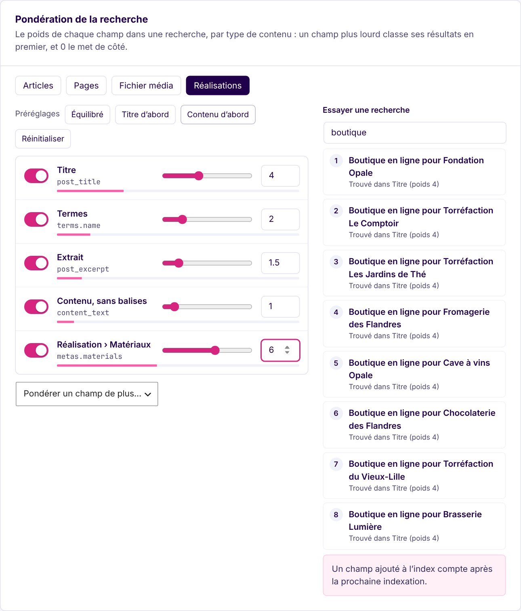
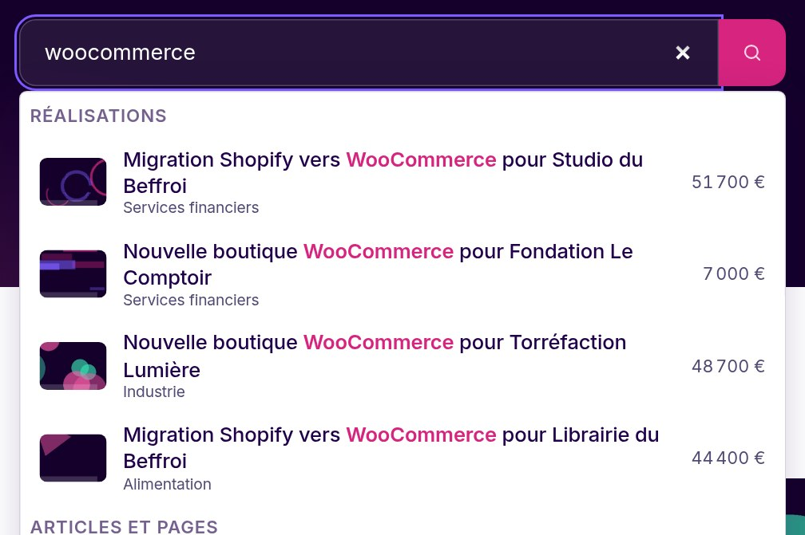

# Search weights and named fields: a step-by-step guide

This guide tunes **what a search finds first**: which fields count (title, terms, excerpt, content, your custom fields) and how much, for each post type, and checks the result on the real site.

- **[Editor mode](#2-in-the-admin)**: the *Search weights* section of MeiliScout › Content. No code.
- **[Developer mode](#6-in-code)**: a filter for the weights, and a function to give a custom field a readable name.

For the principles and every rule, see [WEIGHTS.md](WEIGHTS.md) and [FIELDS.md](FIELDS.md); the design is in [plans/2026-10-search-weights-and-named-fields.md](plans/2026-10-search-weights-and-named-fields.md). The screenshots are of a French admin.

| | |
|---|---|
|  | One tab per post type, a slider per field, and on the right the **ranking the weights give to a real search**, with the reason of each rank. |

## Contents

1. [Before you start](#1-before-you-start)
2. [In the admin](#2-in-the-admin)
3. [Three common settings](#3-three-common-settings)
4. [Weigh a custom field](#4-weigh-a-custom-field)
5. [On the site: search and suggestions](#5-on-the-site-search-and-suggestions)
6. [In code](#6-in-code)
7. [Checking your work](#7-checking-your-work)
8. [Troubleshooting](#8-troubleshooting)

---

## 1. Before you start

1. **MeiliScout connected to Meilisearch**, with your content **indexed** (MeiliScout › Indexation).
2. The **post types** you want to tune are selected in MeiliScout › Content (one weights tab per indexed type).
3. Nothing to turn on: until you save weights, every type is searched with the defaults (title 4, terms 2, excerpt 1.5, content 1), so a site that never opens this screen keeps a sensible ranking.

## 2. In the admin

Open **MeiliScout › Content** and scroll to **Search weights**.

1. **Pick a tab**: one per post type. Weights are set for each, because a product's SKU matters and a page's does not.
2. **For each field**: the **switch** puts it in or out of the search, the **slider** or the **number** sets its weight from 0 to 10 (by halves). The bar under the name is its share of the total. A weight of **0** leaves the field out, in the results *and* in their count.
3. **Presets** set the usual shapes at once: *Balanced*, *Title first*, *Content heavy*. *Reset* returns to the defaults.
4. **Try a search** (right) ranks the type's real results with the weights **as they are on screen, saved or not**, and says what ranked each: *Found in Title (weight 8)*. Move a slider and the ranking follows.
5. **Save** with the bar at the bottom of the screen. A field that was not searched before counts after the next indexation: the screen says so.

The weights are saved with the rest of the Content settings, and travel with the [configuration export](CONFIGURATION.md).

## 3. Three common settings

Each screenshot searches *woocommerce* in the demo's articles.

### Titles first

For a catalogue or a blog where the title says what the page is about: choose **Title first**.


### Content first

For documentation, where the answer is in the text: choose **Content heavy**. Posts that only mention the word in a paragraph rank with the ones that have it in the title.



### Different types, different weights

A type keeps its own weights: here the *Réalisations* tab keeps the default (title 4) while the articles are *Title first*. A search over several types ranks them all with the weights of each.



## 4. Weigh a custom field

*Weigh one more field…* (under the sliders) lists what the type can add: the slug, the raw content, and **the custom fields you [index](FIELDS.md)**, shown by **name** when ACF, Meta Box or WooCommerce declare them (*Réalisation › Matériaux*, not `materials`), with the raw key under it.



A custom field has to be **indexed** to be weighed: add it in *Custom fields* of the same screen (named fields come first, the raw keys after). Nothing is listed in full: you choose what you add. Beyond ACF, Meta Box and WooCommerce, [declare your own](FIELDS.md#declaring-your-own).

## 5. On the site: search and suggestions

Save, run the indexation if the screen asks for it, then search the site (`/?s=woocommerce`). Weights apply to:

- **the WordPress search** (the site search form, `WP_Query` with `s`, the REST API) when it ranks by relevance;
- **the suggestion fields**: a source of posts sends one search per weight in the same request and the browser merges them.

| Title 10, content 0.5 | Title 0.5, content 10 |
|---|---|
|  |  |

What is **not** ranked by weights: a search with an explicit order (`orderby`), facets, and the front listings, which always sort by one of their own sorts (date, title, a meta). A listing's search only looks in the fields that are switched on.

## 6. In code

### Weights

```php
// What a type is searched with: field => weight (0 leaves it out)
add_filter('meiliscout/search_weights', function (array $weights, string $type) {
    if ($type === 'product') {
        $weights['metas._sku'] = 8;
    }

    return $weights;
}, 10, 2);
```

### Name a custom field

```php
add_action('init', function () {
    meiliscout_register_meta_field('budget', [
        'label' => 'Project › Budget',
        'group' => 'Studio',
        'type' => 'number',
        'post_types' => ['project'],
    ]);
});
```

It then reads *Project › Budget* in Content, in the weights and in the listings' facets. Providers and the `meiliscout/meta_fields` filter: [FIELDS.md](FIELDS.md).

## 7. Checking your work

- **Try a search** is the quick check: the ranking and the reason of each rank, before you save.
- On the site, `$query->meiliscout['weighted']` tells how many weight tiers a `WP_Query` search used (absent: not weighted, and `$query->meiliscout['reason']` says why when it ran on MySQL).
- With Query Monitor, the *MeiliScout* panel lists the queries and their parameters; the `X-MeiliScout` header says the same (with `WP_DEBUG`, or for administrators).
- `wp meiliscout check-queries` compares `WP_Query` results on MySQL and Meilisearch; `wp meiliscout check-suggest` checks the suggestion fields.

## 8. Troubleshooting

| Symptom | Likely cause |
|---|---|
| The ranking did not change on the site | The weights are not saved, the search has an explicit order, or the type has one weight for all its fields (a plain search). |
| A field I added never matches | It is not in the index yet: run an indexation (the screen says when). |
| Fewer results than before | A field set to 0 is no longer searched, in the results and in their count. |
| *Try a search* finds nothing for a type | Its fields are all at 0, or the type has no indexed post. |
| The search looks the same as without weights after an error | Meilisearch refused the weighted search: it falls back to an ordinary one and logs `weighted search failed` in the PHP error log. |
| A suggestion field ignores the weights | A cached page carries an older plan (version 1): the cache is purged by the next deployment, or by saving the weights and clearing it. |
